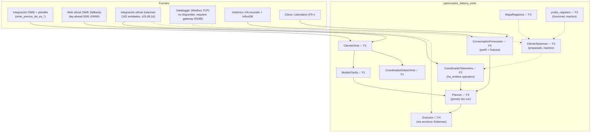
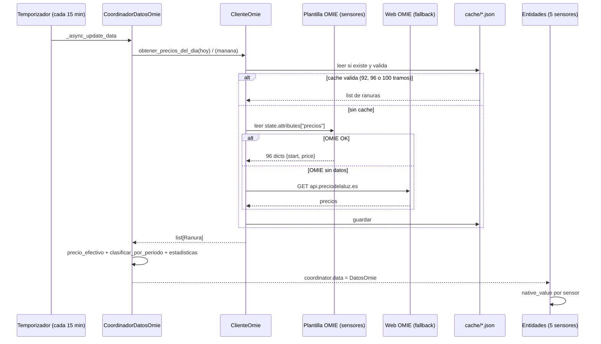
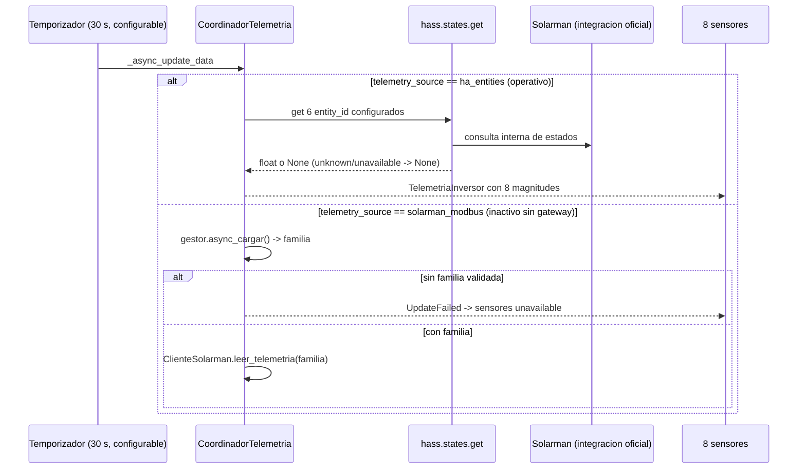
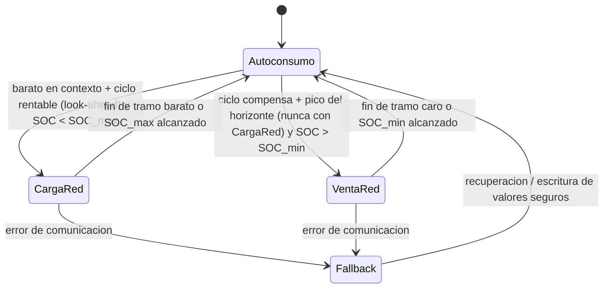

# Diseño y Especificación — `optimizador_bateria_omie`

**Custom component de Home Assistant** para optimizar carga/descarga de batería (inversor Deye vía datalogger Solarman) con precios del mercado eléctrico español en tramos de 15 minutos (OMIE) y predicción de consumo del hogar.

> **Estado del documento** (octubre 2026, v0.9.4). Este documento es la **fuente única de verdad** del proyecto.
>
> - **F1** — Precios: ✅ **implementada y en producción doméstica** (manifest 0.7.3).
> - **F2** — Telemetría: ✅ **completada** (manifest 0.8.10). Vía operativa: **`ha_entities`** (integración oficial Solarman). `solarman_modbus` queda preparado pero inactivo por limitación de hardware del datalogger.
> - **F3** — Predicción v1 + planificador greedy: ✅ **completada** (manifest 0.9.0): perfil estadístico del recorder + **Solcast como fuente preferente de FV** (perfil como fallback por día) + plan greedy en `dry_run` (sin escrituras).
> - **F4** — Control: ✅ **completada** (manifest **0.10.0**): `EjecutorControl` vía servicios `solarman.write_single_register`/`write_multiple_registers`/`read_holding_registers` con write-verify, rate limiter, watchdog, guard dinámico de 5,75 kW, bloqueo por fallo (103-106), activación gradual, fallback con notificación, `force_mode`/`release_manual`, 8 `number` calientes, `switch.control_activo` (default OFF) y auditoría JSONL.
> - **F5** a **F6** — 🚧 diseño, no implementadas.
>
> Cada apartado lleva la marca **✅ F1**, **✅ F2**, **✅ F3**, **🚧 Fn** según corresponda.

---

## 1. Visión general

El componente se ejecuta dentro de Home Assistant y, en su versión completa (F1–F6), hará lo siguiente:

1. **Obtener los precios del mercado diario OMIE con resolución de 15 minutos** (MTU15, operativo en España desde el 1 de octubre de 2025). ✅ F1
2. **Leer el estado del inversor Deye**: SOC, potencias de carga/descarga, consumo de casa, producción FV, **temperatura del inversor y de la batería**. ✅ F2 (vía entidades de la integración oficial Solarman; `solarman_modbus` preparado como alternativa).
3. **Predecir el consumo** con histórico (HA recorder + InfluxDB) + calendario + clima. ✅ F3 (capa 1: perfil estadístico; Solcast para FV) 🚧 F5 (ML + clima)
4. **Calcular un plan horario por tramos de 15 min** que prioriza el autoconsumo y aplica arbitraje. ✅ F3 (greedy en `dry_run`) 🚧 F5 (LP)
5. **Aplicar el plan escribiendo** en el inversor con salvaguardas (dry-run, write-verify, watchdog, fallback). ✅ F4 (vía servicios de Solarman; sin escrituras hasta `control_activo=on`).

Prioridad de estrategia: **autoconsumo + arbitraje cuando convenga**.

**Estado actual**:
- **F1 en producción**: precios OMIE, precio efectivo 2.0TD, clasificación por período tarifario y estadísticas en 5 sensores (se añadió `SensorPreciosEfectivosHoy` como curva completa).
- **F2 completada**: telemetría de 8 sensores (SOC, potencia, corriente, consumo, FV, temperatura inversor, temperatura batería, familia validada) leyendo de la integración Solarman vía `ha_entities`. La vía `solarman_modbus` está implementada y probada pero **no es operativa** con el datalogger actual.
- **F3 completada (0.9.0)**: predicción de consumo por perfil estadístico del recorder (p10/p50/p90 por tramo × tipo de día), previsión FV con **Solcast preferente** y fallback por día al perfil, planificador greedy en `dry_run` (sin escrituras), sensores `prediccion_consumo` / `plan` / `ahorro_estimado_hoy`, `switch.festivo_hoy`, servicio `regenerate_plan` y todos los parámetros editables por `reconfigure`. En **revisión manual de 1 semana** antes de F4.
- **F4 completada (0.10.0)**: `executor.py` escribe en los registros de control (210/211/230/232/217/218 del `registers.yaml`) vía los servicios `solarman.write_*` con write-verify por relectura (`read_holding_registers`), rate limiter (12/h), watchdog, guard dinámico de potencia contratada (95 %/100 %), bloqueo por fallo del inversor, modo gradual (solo CARGA_RED en valle), fallback con `persistent_notification`, auditoría JSONL en `config/optimizador_bateria_omie/`, servicios `force_mode`/`release_manual`, `switch.control_activo` (default OFF → dry-run forzado), 8 `number` calientes y sensor diagnóstico `estado_control`. Deuda #5 (tarifa en `entry.data`) resuelta. **Primera activación real pendiente del usuario** (valle nocturno, observada contra la APP Solarman).
- **F4.5 (0.10.1) — auditoría de ahorro efectivo (anticipada de F5)**: `auditoria.py` (`AuditoriaAhorro`) acumula tramo a tramo (15 min, hora local) el coste real vs. coste sin batería con el precio efectivo 2.0TD; expone `sensor.*_ahorro_efectivo_hoy` con desglose (descarga/carga, red importada/exportada) y persiste en `hass.storage`. Simplificaciones: exportación neteada a precio de importación, potencia del tramo aproximada por la lectura de cierre, sin pérdidas de descarga. Además, `switch.festivo_hoy` ahora persiste el estado el mismo día, se auto-apaga al cambiar de día y con `festivo_manual=True` fuerza valle en el precio efectivo del plan.
- **0.10.2 — fuentes de precios y atributos**: fallback REData (dominio muerto) eliminado; nuevo fallback con la **web oficial de OMIE** (serie SSR day-ahead, €/MWh→€/kWh), garantizando los precios de mañana aunque la integración de plantilla no haya refrescado su sensor. Atributos de `plan` y `prediccion_consumo` compactados a los tramos pendientes (límite de 16 KB del recorder). Aviso de motivo en el plan cuando falta el día D+1, WARNING con la causa y fix de deprecación `device_registry.devices`.
- **0.11.0 — arbitraje con rentabilidad explícita**: `CARGA_RED` requiere look-ahead rentable contra el máximo de precio futuro del horizonte (`precio/η + margen`), lo que habilita la carga nocturna en inviernos caros que el umbral fijo (0,09 €/kWh) bloqueaba. `precio_max_compra` (default 0,5) y `precio_min_venta` (default 0,0) pasan a ser guardarraíles absolutos de seguridad, no criterios de negocio. **Ojo**: entradas existentes conservan sus valores almacenados; mover los `number` si se desea adoptar los nuevos defaults.
- **0.11.1 — venta disciplinada**: detectado en producción que el greedy vendía la batería al primer tramo que superaba `compra_mín/η + margen` (vacándola hasta `soc_min` en llano/noche y dejando la casa importando en punta) e incluso combinaba `CARGA_RED` + `VENTA_RED` en el mismo tramo (importar para verter). Correcciones: venta de batería solo en tramos **pico del horizonte** (precio ≥ máximo futuro, la energía vale más guardada si luego hay algo más caro) y exclusión mutua compra/venta por tramo.
- **0.12.2 — entry.data inmutable (HA 2026.x)**: activar `usar_planificador_lp` (o mover cualquier `number` caliente) levantaba `'mappingproxy' object does not support item assignment: HA convirtió `entry.data` en MappingProxyType. Las escrituras en caliente van ahora por `hass.config_entries.async_update_entry` (helper `escribir_parametro_caliente`, sin recarga de la integración). Además `ForecasterML.entrenar` excluye las filas sin lag7 (la imputación diluía los pesos del ridge; el caso drift del test lo destapó al cambiar la fecha).
- **0.12.3 — ConfigEntry.hass eliminado en HA 2026.11** (INFORME_switch_lp): la 0.12.2 accedia a hass via entry.hass, atributo interno eliminado del core, y switch.usar_planificador_lp y los numbers calientes fallaban con 'ConfigEntry' object has no attribute 'hass'. El helper recibe hass por argumento (entidades: self.hass de plataforma); test de regresion con entry SIN atributo hass. Auditoria de API interna: unica ocurrencia del patron.
- **0.11.2 — evento `optimizador_bateria_omie_sin_telemetria`**: `CoordinadorTelemetria` dispara un evento de HA en cada transición de disponibilidad (data `{"disponible", "motivo"}`; referencia = SOC), para automatizaciones de notificación móvil. La primera observación tras arranque no dispara (evita ruido en reinicios).
- **0.11.3 — activación atómica de `control_activo`**: detectado en la primera activación real: si la escritura de límites SOC (217/218) fallaba al encender el switch, la bandera ya estaba puesta a True → switch en ON con el estado congelado en `inactivo` y sin escribir nunca, sin error visible. Ahora la bandera solo se activa si la escritura tiene éxito; si falla, la activación se aborta quedando OFF con motivo en el sensor (`activación abortada: …`), ERROR en el log y el error relanzado a la UI.
- **0.11.4 — servicios de Solarman 25.x**: la primera activación real destapó que la integración Solarman renombró sus servicios (el bloqueo real era `not a valid option at 'register'` del servicio legado inexistente). `EscritorSolarman` detecta en caliente la generación instalada y usa la actual — `write_holding_register`, `write_multiple_holding_registers`, `read_multiple_holding_registers` con campo `count` y respuesta `{registro: valor}` — con fallback a los nombres legados (`write_single_register`, `write_multiple_registers`, `read_holding_registers` con `quantity`).
- **0.11.5 — escrituras siempre por FC 16**: segunda lección de la activación real: el datalogger Deye responde ACKNOWLEDGE (excepción Modbus 5, "long duration of time…") a la escritura individual FC 6, tal como avisa el services.yaml de Solarman. TODAS las escrituras (individuales incluidas) van por `write_multiple_holding_registers` con `values=[valor]`.
- **0.11.6 — SOC mínimo en caliente sincroniza el inversor**: detectado en la primera activación real: mover el `number` de SOC mínimo solo actualizaba `entry.data` y replanificaba, pero 217/218 no se reescribían hasta la siguiente activación (el README prometía "al activar o cambiar parámetros"). Ahora `number.soc_minimo` con `control_activo` ON invoca `EjecutorControl.async_actualizar_limites_soc()` (217/218 al instante, visible en la entidad Solarman `battery_shutdown_soc`); con OFF se aplazan a la activación (dry-run). **Decisión de diseño confirmada por el usuario (opción A): suelos acoplados** — el `soc_min` del planificador se escribe en el Shutdown SOC del inversor (217) en cada activación y cambio en caliente, garantizando que el corte físico del Deye coincide con el suelo del plan (corte por encima → planes no ejecutables; por debajo → descarga más profunda que la contemplada).
- **F5 (0.12.0) — ML + LP**: forecaster ML con **guardrail de adopción** — solo predice si su MAPE (holdout 70/30) mejora el perfil de F3, `festivo_hoy` cae al perfil; reentrenamiento diario (04:35) en executor job, persistencia en `config/`; sensor diagnóstico `forecast_quality`. Planner **LP** (PuLP 3.x + CBC) con el mismo contrato del greedy (executor y salvaguardas intactos), selector en caliente `switch.usar_planificador_lp` (default greedy) y fallback automático; modelo con balance de nodo, exclusividades por tramo, curtail solo de FV, D10 dura y guardarraíles absolutos. Auditoría refinada: energía por tramo con **media real de lecturas** y exportación con `factor de precio de excedentes` (number, default 1, nunca negativos). Clima AEMET opcional (weather para predicción, sensor de temperatura para entrenamiento, ambos por reconfigure). Dependencias: numpy y pulp <4.
- **0.12.1 — scikit-learn fuera, ridge en numpy puro**: el primer despliegue de F5 en el HA Yellow falló en carga (`Requirements ... not found: scikit-learn`): verificado empíricamente que **scikit-learn no publica wheels musl (Alpine) en ARM64 en ninguna versión**, así que es instalable imposible en HAOS. `ForecasterML` se reimplementó como **regresión ridge (forma cerrada, numpy)** con la misma interfaz, features, imputación por medias, banda por cuantiles de residuos, MAPE y guardrail — entrenamiento aún más ligero. Persistencia con pickle stdlib. numpy sí tiene wheels musl y PuLP es puro Python.

---

## 2. Contexto del sistema existente

| Elemento | Detalle |
|---|---|
| Plataforma | Home Assistant Yellow (HAOS), en uso desde ~2023 |
| Python / HA | Python **3.14**, Home Assistant **2026.10.1** |
| Inversor | **Deye SUN-6K-SG05LP1-EU-AM2-P** — híbrido monofásico, 6.000 W, PV máx. 7.800 W, batería 40–60 V, corriente máx. carga/descarga **0–135 A** |
| Batería | **Docan 51,2 V 300 Ah LiFePO4** — **15,36 kWh nominales**; 140 A recomendados, 135 A límite del inversor (≈ 6,9 kW) |
| Datalogger | Solarman serie **3178171873**, IP fija **192.168.1.76**, puerto 8899 |
| **Integración Solarman** | Instalada y operativa (v25.08.16) — publica **162 entidades** (`sensor.inversor_*`). Fuente de telemetría de F2 vía `ha_entities` y **fuente de escritura para F4**. |
| Históricos | **HA recorder** (reciente) + **InfluxDB** (anterior) — ambos intactos, disponibles para F3 |
| **Fuente de precios** | Integración oficial OMIE + plantilla `precios_omie.yaml` (§5.1) |
| Clima | Integración weather de HA (pendiente de confirmar en F5) |
| Tarifa | Indexada **2.0TD** con **5,75 kW contratados**; peajes y cargos en §5.6 |
| Remuneración excedentes | **Al mismo precio que la compra** (contrato con mayorista) |

**Limitación confirmada del datalogger** (F2): el datalogger serie `3178171873` **no expone Modbus TCP local**. Los puertos 8899 y 502 están cerrados al protocolo Modbus, aunque la IP responde a ping. La integración oficial Solarman usa un protocolo propietario que sí funciona, y es la vía que se usará tanto para leer (F2) como para escribir (F4).

---

## 3. Requisitos funcionales

### RF-01 — Precios OMIE a 15 minutos ✅ F1

- Precios del mercado diario español (MDA) con resolución de **15 minutos** para hoy y mañana, en €/kWh.
- Fuentes en cascada:
  1. **Sensores de plantilla** `sensor.omie_precios_de_es_{ayer,hoy,manana}`, creados con `omie.get_prices_for_date` (§5.1).
  2. **Web oficial de OMIE** (`www.omie.es/es/market-results/daily/daily-market/day-ahead-price?date=...&period=15&scope=daily`): la página incrusta en el HTML (SSR) la serie Highcharts «Precio marginal español» con los 96 precios en €/MWh (92/100 en DST). Fallback cuando la plantilla no tiene datos (p. ej. sensor de mañana sin refrescar tras la publicación D+1 ~13:45). El dominio REData anterior (`api.preciodelaluz.es`) desapareció y fue eliminado en 0.10.2.
- **Caché en disco** por día (`cache/YYYY-MM-DD.json`), validada a **92, 96 o 100 tramos** (días DST).
- **Refresco**: coordinador cada 15 min + triggers de la plantilla (13:35 y 00:05 CET) + arranque HA.
- **Expuesto**: precio del tramo actual, precio efectivo, clasificación por **período 2.0TD** (valle/llano/punta) y estadísticas (mín/máx/mediana) + curva completa de precios efectivos del día.

### RF-02 — Telemetría del inversor ✅ F2

- **Vía operativa: `ha_entities`** — lectura de las entidades que publica la integración oficial Solarman mediante `hass.states.get()`.
- **8 sensores publicados**:
  - `soc_bateria` (%)
  - `potencia_bateria` (W, **+descarga/−carga** — convención Deye)
  - `corriente_bateria` (A) — `None` en modo `ha_entities` (disponible cuando se active `solarman_modbus` o vía `entity_id_corriente_bateria`).
  - `consumo_casa` (W)
  - `produccion_fv` (W)
  - **`temperatura_inversor` (°C)** — usada por automatización del ventilador externo
  - **`temperatura_bateria` (°C)**
  - `familia_validada` (diagnóstico) — siempre `ninguna` en `ha_entities`
- **Refresco**: 30 s configurable (10–300 s).
- **Vía preparada: `solarman_modbus`** — implementada en `ClienteSolarman` con `pysolarmanv5`, `MapaRegistros` de dos familias (A/B), `probe_registers` con tolerancia ±2 %, plausibilidad y reset. **No operativa** hasta disponer de gateway RS485.
- **F2 es estrictamente de solo lectura**.

### RF-03 — Control de carga/descarga ✅ F4

- Servicios para ajustar corriente/potencia de carga y descarga, SOC objetivo, SOC mínimo, carga desde red y venta a red.
- **Mecanismo de escritura**: uso de los servicios de la integración oficial: generación 25.x (`write_holding_register` / `write_multiple_holding_registers` / `read_multiple_holding_registers` con campo `count`) con detección en caliente de los nombres legados (`write_single_register` / `write_multiple_registers` / `read_holding_registers` con `quantity`). La integración RENOMBRÓ sus servicios en 25.x; lo deprecado era el naming antiguo.
- **Mapa de registros configurable** en `registers.yaml` (nunca en código). `probe_registers` valida familia antes de permitir escrituras (en caso de usar `solarman_modbus`).
- Límite de seguridad: **máx N escrituras por hora** (default 12, configurable 1–48) + **write-verify** tras cada escritura (relectura a los `latencia_verify_s`, 3 s; 3 fallos consecutivos → fallback con valores seguros 232=0/230=0 + `persistent_notification` + reactivación solo manual). ✅ F4

### RF-04 — Compra/venta con parámetros ajustables ✅ F4 (guard) 🚧 F5 (LP)

- **Comprar** (cargar desde red) cuando el tramo sea barato en contexto (bajo la mediana del día) **y el ciclo compense contra el máximo de precios futuro del horizonte**: `p_descarga_futura_max ≥ p_compra / η_round_trip + margen` (0.11.0, look-ahead); por debajo del tope de seguridad absoluto `precio_max_compra` (default 0,5 €/kWh).
- **Vender** (verter a red) cuando el precio supere el piso de seguridad `precio_min_venta` (default 0; bloquea negativos), compense la eficiencia round-trip — `p_venta ≥ p_compra_efectiva / η_round_trip + margen` — **y el tramo sea un pico del horizonte** (`p_venta ≥ máximo de precios futuro`; 0.11.1) — si más adelante hay algo igual o más caro, la energía vale más guardada para autoconsumo. `CARGA_RED` y `VENTA_RED` son **excluyentes por tramo**: nunca se importa de red para verter a red. Venta al mismo precio que la compra (§5.6).
- **Restricción dura**: importación total (consumo + carga batería) ≤ **5,75 kW**.
- Todos los umbrales como entidades `number`/`switch` modificables sin reiniciar. ✅ F4: 8 `number` calientes + guard dinámico (importación vía registro 169 o cálculo derivado; > 95 % → reduce; ≥ 100 % → 0 A).

### RF-05 — Predicción de consumo ✅ F3 (capa 1) 🚧 F5 (ML)

- Predicción de consumo por tramos de 15 min para hoy + mañana.
- **Fuentes de histórico disponibles**:
  - **HA recorder**: datos recientes. ✅ **Usado en F3** (`historico.py` + `FuenteHistoricoRecorder`, ventana configurable 7–90 días, default 28).
  - **InfluxDB**: histórico completo — **TODO documentado**, no consultado en F3.
- Features del modelo: `tramo_dia`, `dia_semana`, `es_festivo`, `es_vacaciones`, `temperatura_media`, `irradiancia`, `consumo_mismo_tramo_{7,14,21,28}d`.
- Implementación por capas:
  1. **F3** ✅: perfil estadístico (mediana p50 por tramo × tipo de día con banda p10–p90; cascada tipo → opuesto → global → `None` sin inventar valores).
  2. **F5**: ML (Gradient Boosting / LightGBM con scikit-learn).
- **Previsión FV (F3)** ✅: **Solcast PV Forecast como fuente preferente** (`detailedForecast` de las entidades de hoy y mañana, mapeo 30→15 min por repetición, kWh/periodo → W) con **fallback por día al perfil estadístico**; fuente expuesta como atributo `fuente_fv`.

### RF-06 — Planificador y ejecutor ✅ F3 (greedy dry-run) 🚧 F4 (executor) / F5 (LP)

- Plan por tramos de 15 min: `AUTOCONSUMO` / `CARGA_RED` / `VENTA_RED` / `MANTENER`, potencia objetivo, SOC previsto, beneficio marginal estimado.
- **F3** ✅: planner greedy en `dry_run` (`planificador.py` + `coordinador_plan.py` + `sensor.plan` + `sensor.ahorro_estimado_hoy` + `switch.festivo_hoy` + servicio `regenerate_plan`). **Sin escrituras al inversor**.
- **F4** ✅: executor con write-verify, límite de escrituras, watchdog, guard y fallback (ver §5.11).
- **F5**: LP con PuLP/SciPy.

---

## 4. Arquitectura

### 4.1 Diagrama de componentes (F1 + F2 + F3+)



**Línea continua** = operativa. **Línea discontinua** = preparada/inactiva (gateway RS485) o en diseño (F4).

### 4.2 Ciclo de actualización de precios ✅ F1



### 4.3 Ciclo de telemetría ✅ F2



### 4.4 Máquina de estados de la batería (F4+)



---

## 5. Módulos del componente

### 5.1 `ClienteOmie` ✅ F1

Fichero: `cliente_omie.py`.
- `obtener_precios_del_dia(fecha)`: Caché → OMIE (plantilla) → web oficial OMIE (SSR) → normalización.
- `limpiar_cache_antigua(dias)`: Borra `cache/*.json` con `mtime > dias * 86400`, en executor.
- **Caché válida** si tiene **92, 96 o 100 ranuras** (DST).
- **Zona horaria**: selección de sensor por **fecha local**.

### 5.2 `ClienteSolarman` y `CoordinadorTelemetria` ✅ F2

- `CoordinadorTelemetria`: ramifica según `telemetry_source`.
  - **`ha_entities`** (operativo): consulta `hass.states.get()` para los 6 `entity_id` configurados. Valores `unknown`/`unavailable` → `None`.
  - **`solarman_modbus`** (preparado): `UpdateFailed` antes de tocar Modbus si no hay familia validada.
- `MapaRegistros`: carga `registers.yaml` con override de usuario. Soporta `offset` (temperaturas), two's complement (`signed: true`) e `invertir_signo`.
- `GestorValidacion`: persistencia en `hass.storage.Store` (`optimizador_bateria_omie/probe.json`).

### 5.3 `registers.yaml` y familias Deye ⚠️ (preparado, inactivo)

**Estado**: el fichero existe, está validado por `MapaRegistros`, y el mapa de **familia estándar** está confirmado contra los manuales `Deye sunsynk modbus.pdf` y `Deye.Modbus.protocol.V118.pdf`.

**No se usa operativamente** para lectura porque el datalogger no expone Modbus TCP. Queda preparado para cuando se instale un gateway RS485. Sin embargo, los **registros de control** ya están mapeados para F4 (escritura vía servicios de Solarman).

Contenido del `registers.yaml` empaquetado:

```yaml
inverter: "deye-sun-6k-sg05lp1-am2"
block_size: 16
familias:
  estandar:
    probe:  { funcion: soc, addr: 184 }
    plausibility:
      soc:          [0, 100]
      potencia_bat: [-7000, 7000]
    telemetria:
      soc:                  { addr: 184, scale: 1,    unit: "%" }
      potencia_bat:         { addr: 190, scale: 1,    unit: "W",  signed: true, invertir_signo: false, signo_semantico: "+descarga/-carga" }
      corriente_bat:        { addr: 191, scale: 0.01, unit: "A",  signed: true }
      voltaje_bat:          { addr: 183, scale: 0.01, unit: "V" }
      temperatura_inversor: { addr: 90,  scale: 0.1,  unit: "°C", offset: 1000 }
      temperatura_bateria:  { addr: 182, scale: 0.1,  unit: "°C", offset: 1000 }
      consumo_casa:         { addr: 178, scale: 1,    unit: "W",  signed: true }
      produccion_fv:        { addr: 186, scale: 1,    unit: "W" }
    control:  # Usado por el Executor (F4) vía servicios de Solarman
      corriente_carga:    { addr: 210, min: 0, max: 135 }
      corriente_descarga: { addr: 211, min: 0, max: 135 }
      corriente_carga_red:{ addr: 230, min: 0, max: 135 }
      habilitar_carga_red:{ addr: 232, valores: [0, 1] }
      soc_minimo:         { addr: 217, min: 10, max: 100 }
      soc_recuperacion:   { addr: 218, min: 10, max: 100 }
```

### 5.4 `ConsumptionForecaster` ✅ F3

- **F3**: perfil estadístico de consumo (`historico.py` + `predictor_consumo.py`) + **Solcast PV Forecast como fuente preferente de producción FV** (con fallback por día al perfil estadístico si Solcast no está disponible o falla).
- **F5**: ML con scikit-learn.

### 5.5 `Planner` ✅ F3

- **F3**: greedy con reglas heurísticas en `dry_run`.
- **F5**: LP con PuLP/SciPy, restricción importación ≤ 5,75 kW.
- Sensor `ahorro_estimado_hoy` con `coste_sin_plan` vs `coste_con_plan`.

### 5.6 `ModeloTarifa` ✅ F1

- `ConfiguracionTarifa(potencia_contratada_kw=5.75, impuesto_electrico_pct=0.051127, iva_pct=0.21, aplicar_impuestos_precio=True)`.
- `PeriodoTarifa` (`es_punta`, `es_llano`, `es_valle` sobre hora local).
- `obtener_precio_efectivo(precio_spot, fecha_hora_utc)`.
- **Clasificación**: `clasificar_por_periodo` (período 2.0TD real). `clasificar_por_percentiles` queda como utilidad auxiliar para el planner (F3+).
- **Peajes/cargos/impuestos siguen hardcodeados** en `tarifa.py` — mover a `entry.data` es deuda #5 (F4).

### 5.7 `CoordinadorDatosOmie` ✅ F1

- `_async_update_data() -> DatosOmie`, `update_interval = 15 min`.
- `_buscar_ranura(ranuras, ahora)` en UTC, con fallback a `precios_manana` en la madrugada local.

### 5.8 `entidades.py` y `entidades_solarman.py` ✅ F1 + ✅ F2

**F1** (`entidades.py`): `SensorBase(CoordinatorEntity, SensorEntity)` + 5 sensores de precio.

**F2** (`entidades_solarman.py`): `SensorTelemetriaBase(CoordinatorEntity, SensorEntity)` + **8 sensores** (SOC, Potencia, Corriente, Consumo, FV, Temp. Inversor, Temp. Batería, Familia Validada).

### 5.9 `sensor.py` ✅ F1 + ✅ F2

- F1: crea `ClienteOmie` + `CoordinadorDatosOmie` + 5 entidades de precio.
- F2: lee `entry.data`, instancia `MapaRegistros` + `GestorValidacion` + `CoordinadorTelemetria`. Añade las 8 entidades de telemetría.

### 5.10 `config_flow.py` ✅ F1 + ✅ F2 + ✅ F3

- F1: 3 campos + `_abort_if_unique_id_configured()`.
- F2: campos nuevos (`ip`, `puerto`, `serie`, `telemetry_source`, `intervalo_telemetria_s`, 6 `entity_id`).
- F3: añade `switch.festivo_hoy`, servicio `regenerate_plan` y amplía `reconfigure`.

### 5.11 `Executor` ✅ F4

Fichero: `executor.py`.

**Mecanismo de escritura**: llamadas a los servicios de la integración oficial Solarman:
- Escrituras SIEMPRE vía bloque FC 16 (`write_multiple_holding_registers`), individuales incluidas: el Deye rechaza la FC 6 con ACKNOWLEDGE (0.11.5).
- `solarman.write_multiple_holding_registers` (o legado `write_multiple_registers`) para bloques contiguos.
- **`solarman.write_multiple_holding_registers` está deprecado y no se usará.**

**Flujo**:
1. El planificador (F3) emite un plan con acciones (`AUTOCONSUMO`, `CARGA_RED`, `VENTA_RED`).
2. El Executor traduce cada acción a valores concretos de los registros 210, 211, 230, 232.
3. Si `dry_run=True` (por defecto), solo loguea las escrituras. No las ejecuta.
4. Si `dry_run=False`, invoca el servicio de Solarman y espera **3 segundos** (latencia observada).
5. Relee el registro escrito vía `hass.states.get` (o vía el propio servicio si expone lectura) para verificar el cambio.
6. Si el `write-verify` falla 3 veces consecutivas (valor leído ≠ escrito; los errores de relectura cuentan como verify "parcial" y no suman), activa `fallback`: escribe los valores seguros (232=0, 230=0 del YAML, sin pasar por el rate limiter), apaga `control_activo` automáticamente, emite `persistent_notification` y exige reactivación manual.

**Implementación real (F4)**: `EscritorSolarman` aísla el payload de los servicios de Solarman (25.x: `write_holding_register` / `write_multiple_holding_registers` / `read_multiple_holding_registers`; legados detectados en caliente) (device configurado o resolución automática del primer device de la integración). `EjecutorControl` traduce cada acción a registros: 210 = corriente equivalente a `potencia_max_carga` (constante entre tramos, nunca la corriente del tramo para no estrangular la carga solar), 230/232 solo carga desde red, 211 solo en VENTA_RED; conversión W→A con `voltaje_bateria_nominal` (51,2 V) y recorte SIEMPRE a los límites del YAML (0–135 A). Al activar se escriben 217/218 con `soc_recuperacion > soc_min`. `modo_activacion` gradual (default): solo CARGA_RED en valle 2.0TD se ejecuta; el resto se simula y se audita. Watchdog (telemetría > 2× intervalo o plan ausente → no escribir; carga activa → fallback). Bloqueo por fallo (entity_ids_fallo, Deye 103-106 ≠ 0). Auditoría JSONL append-only en `config/optimizador_bateria_omie/auditoria_escrituras.jsonl` con `{ts, tramo, accion, registros, ejecutada, verificado, latencia, motivo, guard}`.

**Entidad habilitadora**: `switch.optimizador_bateria_omie_control_activo`. Por defecto en `off`. Hasta que el usuario lo active, ninguna escritura real (todo se traduce, loguea y audita con `ejecutada: false`).

**Límite de escrituras**: máximo 12/hora (1–48 configurable), ventana deslizante; superado → aplazado al siguiente tramo con WARNING.

---

## 6. Entidades y servicios de Home Assistant

### 6.1 Entidades F1 ✅

| Entidad | Estado | Atributos |
|---|---|---|
| `precio_actual` | Precio del tramo (€/kWh) | `fuente` |
| `precio_efectivo` | Precio con impuestos | — |
| `precio_clasificacion` | `valle` / `llano` / `punta` | — |
| `precio_estadisticas` | Mediana del día | `min`, `max`, `mediana`, `fuente` |
| `precios_efectivos_hoy` | Mediana + curva completa | `precios_ordenados` |

### 6.2 Entidades F2 ✅

8 sensores listados en §5.8. En modo `ha_entities`, todos publican datos excepto `corriente_bateria` (si no se configura su `entity_id`) y `familia_validada` (siempre `ninguna`).

### 6.3 Entidades F3 ✅ y planificadas 🚧 F4–F5

| Entidad | Tipo | Fase |
|---|---|---|
| `sensor.*_prediccion_consumo` | W + curva p10/p50/p90 | ✅ F3 |
| `sensor.*_plan` | acción y potencia del tramo actual | ✅ F3 |
| `sensor.*_ahorro_estimado_hoy` | € ahorrados estimados | ✅ F3 |
| `switch.*_festivo_hoy` | marca manual festivo/vacaciones | ✅ F3 |
| `sensor.*_ahorro_efectivo_hoy` | € ahorrados reales (auditoría, con desglose) | ✅ 0.10.1 |
| `sensor.*_forecast_quality` | MAPE del backtest (ML vs perfil, guardrail) | ✅ F5 (0.12.0) |
| `switch.*_usar_planificador_lp` | planner LP en caliente (default greedy) | ✅ F5 (0.12.0) |
| `number.*_precio_excedentes` | factor 0–1 de valoración de excedentes (auditoría) | ✅ F5 (0.12.0) |
| `switch.*_control_activo` | habilita escritura (default OFF → dry-run forzado) | ✅ F4 |
| `number.*_precio_max_compra` | tope de seguridad de compra (0–1 €/kWh, default 0,5); el negocio lo decide la rentabilidad del ciclo | ✅ F4 |
| `number.*_precio_min_venta` | piso de seguridad de vertido (default 0; bloquea negativos); la venta de batería la guarda el margen | ✅ F4 |
| `number.*_margen_arbitraje` | margen mínimo | ✅ F4 |
| `number.*_soc_min` / `_soc_max` | límites SOC | ✅ F4 |
| `number.*_potencia_max_carga` / `_descarga` | límites potencia | ✅ F4 |
| `number.*_eficiencia_round_trip` | 70–95 % | ✅ F4 |
| `sensor.*_estado_control` | inactivo/dry_run/activo/fallback_bloqueado (diagnóstico) | ✅ F4 |

### 6.4 Servicios

**F2 ✅ — `optimizador_bateria_omie.probe_registers`**: funcional, inactivo en `ha_entities`.

**F3 ✅ — `optimizador_bateria_omie.regenerate_plan`**: fuerza un recálculo del plan (sin argumentos).

**F4 ✅ — `force_mode(mode, until)` / `release_manual`**: el modo manual respeta TODAS las salvaguardas y expira solo en `until` (ISO 8601 futuro); `release_manual` lo libera inmediatamente.

---

## 7. Parámetros ajustables

### 7.1 Config flow actual ✅ F1 + ✅ F2 + ✅ F3

| Parámetro | Tipo | Default | Valores |
|---|---|---|---|
| `fuente_prioritaria` | selección | `omie` | `omie` (fallback web OMIE automático) |
| `usar_cache` | bool | `true` | — |
| `dias_cache` | int | `7` | 1–30 |
| `telemetry_source` | selección | **`ha_entities`** | `ha_entities`, `solarman_modbus` |
| `ip` / `puerto` / `serie` | str/int | datalogger | editables |
| `intervalo_telemetria_s` | int | `30` | 10–300 |
| `entity_id_soc_bateria` … `entity_id_temp_bateria` | str | vacío | solo con `ha_entities` |
| `ventana_historico_dias` | int | `28` | 7–90 |
| `festivos_locales` | lista | vacío | "MM-DD" |

### 7.2 Modelo de tarifa ✅ F1 (hardcodeado)

Peajes, cargos, impuestos y potencia contratada en `entry.data` (`ConfiguracionTarifa.desde_entry`, defaults = valores confirmados 2.0TD). ✅ **Deuda #5 resuelta en F4**; la entrada de producción no cambia de comportamiento.

---

## 8. Fases de implementación

| Fase | Alcance | Estado | Criterio de salida |
|---|---|---|---|
| **F1 — Precios** | `ClienteOmie` + `ModeloTarifa` + `CoordinadorDatosOmie` + 5 sensores + config flow | ✅ **completada** (0.7.3) | Precios coinciden con OMIE; clasificación 2.0TD correcta; precio efectivo validado |
| **F2 — Telemetría** | `ClienteSolarman` (preparado) + `MapaRegistros` + `registers.yaml` + `CoordinadorTelemetria` (`ha_entities` operativo) + `probe_registers` + **8 sensores** | ✅ **completada** (0.8.10) | SOC, potencia y temperaturas operativos; convención Deye confirmada; automatización del ventilador funcionando |
| **F3 — Predicción v1 + Planner greedy** | `historico.py` + `predictor_consumo.py` (perfil + Solcast) + `planificador.py` (greedy) + `coordinador_plan.py` + 3 sensores + `switch.festivo_hoy` + servicio `regenerate_plan` | ✅ **completada** (0.9.0) | Plan diario plausible 1 semana en `dry_run` (revisión manual en curso) |
| **F4 — Control** | `executor.py` (`EscritorSolarman` + `EjecutorControl`) con write-verify, rate limiter, watchdog, guard dinámico, bloqueo por fallo, gradual, fallback, auditoría JSONL, `force_mode`/`release_manual`, `switch.control_activo` + 8 `number` + `sensor.estado_control`; deuda #5 resuelta | ✅ **completada** (0.10.0) | 1 semana sin errores con `control_activo=on` en gradual; solo carga en valle; escrituras verificadas contra la APP; **primera activación real pendiente del usuario** |
| **F4.5 — Auditoría de ahorro (anticipada de F5)** | `auditoria.py` (`AuditoriaAhorro`) + `sensor.ahorro_efectivo_hoy` + festivo persistente con auto-off diario | ✅ **completada** (0.10.1) | Ahorro real del día visible y coherente con la tarifa efectiva; simplificaciones documentadas |
| **F5 — ML + LP** | Forecaster ML + LP + banda p90 + reentrenamiento + refinado de la auditoría (precio de excedentes, perfil real por tramo) | ✅ **implementada** (0.12.0) | MAPE < 20 %; ahorro real medible — **observación del usuario en curso**; entidades: `forecast_quality`, `usar_planificador_lp`, `number precio_excedentes`, clima AEMET opcional |
| **F6 — Pulido** | Dashboard, notificaciones, informes | 🚧 pendiente | 30 días sin intervención |

---

## 9. Seguridad y resiliencia

### 9.1 Principios no negociables

- `dry_run` por defecto `true` (F4+): plan publicado pero nunca escrito hasta validación explícita.
- **Write-verify**: relectura tras cada escritura (espera 3 s); 3 fallos consecutivos → `fallback` + bloqueo hasta intervención.
- **Nunca permitir**: SOC < límite de descarga, corrientes > límites del `registers.yaml`, escrituras con alarma/fault.
- **Guard de potencia contratada**: importación ≤ 5,75 kW; si supera 95 %, reducir corriente de carga.
- **Sin datos → no inventar**: si no hay precios, plan con lo disponible; si no hay telemetría, sensores `unavailable`.
- **Auditoría inmutable** (JSONL) de planes, escrituras y errores.

### 9.2 Aplicación en F1, F2 y F3

- **F1**: Coordinador sin escrituras; `UpdateFailed` si todas las fuentes fallan; caché validada.
- **F2**: Lectura pasiva en `ha_entities`; sin escrituras en `ClienteSolarman`.
- **F3**: Planificador en `dry_run`; sin escrituras al inversor.

---

## 10. Pruebas

### 10.1 F1 ✅ (62 tests en verde)

- `test_normalizar_a_15min.py`, `test_cliente_omie.py`, `test_tarifa.py`, `test_coordinador.py`.

### 10.2 F2 ✅ (implementados)

- `tests/fake_inversor.py` — `InversorFake` con `connect()`/`disconnect()`.
- `tests/test_mapa_registros.py` — YAML válido/inválido, override, `offset`, `invertir_signo`.
- `tests/test_solarman_client.py` — familia por parámetro, troceado ≤16, backoff, signed.
- `tests/test_telemetria.py` — `ha_entities`, `UpdateFailed` sin familia.
- `tests/test_probe_registers.py` — tolerancia ±2 %, plausibilidad, reset.
- `tests/test_mantenimiento.py` — limpieza de caché.

### 10.3 F3 ✅ (implementados)

- `test_planificador.py`: escenarios valle/punta, precio negativo, SOC 0/50/100, venta deshabilitada.
- `test_predictor_consumo.py`: dataset sintético, backtesting con seed fija.

### 10.4 F4 ✅ (implementados)

- `test_executor.py`: traducción de registros (direcciones del YAML), dry-run, gradual/completo, límites, write-verify OK/fallo/parcial, fallback, rate limiter, watchdog, guard 95 %/100 %, bloqueo por fallo, auditoría JSONL.
- `test_force_mode.py`: aplicación inmediata, expiración solo en `until`, release manual, validaciones, salvaguardas respetadas.
- `test_entidades_control.py`: switch, 8 numbers calientes con recálculo, sensor de estado, params del entry.
- `test_tarifa_entry_data.py`: deuda #5.

---

## 11. Estructura del repositorio (post-F3)

```
optimizador-bateria-omie/
├── custom_components/
│   └── optimizador_bateria_omie/
│       ├── __init__.py              # setup entry + job caché + servicios
│       ├── manifest.json            # versión 0.9.4
│       ├── const.py                 # DOMAIN, defaults, CONF_*, unique_ids
│       ├── config_flow.py           # ConfigFlow + reconfigure
│       ├── cliente_omie.py          # F1 + deuda #1, #2
│       ├── tarifa.py                # F1 (hardcoded)
│       ├── coordinador.py           # F1 + log deuda #7
│       ├── entidades.py             # F1: SensorBase + 5 sensores
│       ├── entidades_solarman.py    # F2: SensorTelemetriaBase + 8 sensores
│       ├── sensor.py                # setup de plataforma (F1 + F2 + F3)
│       ├── mapa_registros.py        # F2 (soporta offset)
│       ├── solarman_client.py       # F2 (preparado, inactivo)
│       ├── telemetria.py            # F2: TelemetriaInversor + GestorValidacion + CoordinadorTelemetria
│       ├── historico.py             # F3: FuenteHistoricoRecorder
│       ├── predictor_consumo.py     # F3: perfil + Solcast
│       ├── planificador.py          # F3: greedy
│       ├── coordinador_plan.py      # F3: coordinator del plan
│       ├── entidades_plan.py        # F3: plan y ahorro + 0.10.1: festivo persistente, ahorro efectivo
│       ├── auditoria.py             # 0.10.1: AuditoriaAhorro (ahorro real del día)
│       ├── executor.py              # F4: EscritorSolarman + EjecutorControl
│       ├── entidades_control.py     # F4: switch.control_activo, 8 numbers, sensor estado
│       ├── number.py                # F4: plataforma number
│       ├── switch.py                # F3+F4: switch.festivo_hoy, switch.control_activo
│       ├── services.py              # F2+F3+F4: probe, regenerate_plan, force_mode, release_manual
│       ├── services.yaml            # F2 + F3
│       ├── strings.json             # JSON puro (sin comentarios)
│       ├── translations/
│       │   └── es.json              # JSON puro
│       ├── registers.yaml           # F2 (familia estándar)
│       ├── cache/                   # runtime
│       └── tests/
│           └── (F1 + F2 + F3)
├── hacs.json
├── README.md
├── SPEC.md                          # este documento
├── PLAN_F2V1.3.md / PLAN_F3.md / PLAN_F4.md   # planes cerrados
└── RESULTADO_F2.md / RESULTADO_F3.md / RESULTADO_F4.md   # resultados de fase
```

**`manifest.json` final**:

```json
{
  "domain": "optimizador_bateria_omie",
  "name": "Optimizador Batería OMIE",
  "documentation": "https://github.com/acarrilloa/optimizador-bateria-omie",
  "issue_tracker": "https://github.com/acarrilloa/optimizador-bateria-omie/issues",
  "codeowners": ["@acarrilloa"],
  "config_flow": true,
  "version": "0.10.0",
  "requirements": ["pysolarmanv5>=3.0.6,<4.0.0"],
  "dependencies": ["omie", "recorder"],
  "iot_class": "local_polling",
  "homeassistant": "2026.10.1",
  "license": "MIT"
}
```

**Paquetes**: solo `pysolarmanv5`. **NO** `voluptuous` ni `PyYAML` (vienen con HA Core).

**Ficheros futuros** (F5+): `executor.py` ya existe (F4); F5 añadirá el forecaster ML y el LP sobre los módulos existentes.

---

## 12. Datos pendientes y deuda técnica

### 12.1 Confirmados

- Inversor Deye SUN-6K-SG05LP1-EU-AM2-P.
- Batería Docan 51,2 V 300 Ah (15,36 kWh).
- Datalogger Solarman serie 3178171873 (Modbus TCP **no disponible**).
- Tarifa 2.0TD con 5,75 kW contratados.
- Remuneración simétrica.
- Fines de semana y festivos nacionales → **valle**.
- **Convención Deye `+descarga/−carga`** verificada empíricamente.
- **Telemetría vía `ha_entities` operativa**.
- **Históricos**: HA recorder + InfluxDB intactos.
- **Automatización del ventilador** basada en `sensor.optimizador_bateria_omie_temperatura_inversor` funcionando.
- **Mecanismo de escritura F4**: ✅ **RESUELTO**. Se usarán los servicios `solarman.write_multiple_registers` / `solarman.write_single_register` de la integración oficial. **No requiere gateway RS485.**

### 12.2 Pendientes de confirmar / bloqueos

1. **Entidad de clima** — F5 (el perfil F3 no usa clima).
2. **Previsión FV** — ✅ **Solcast PV Forecast confirmada** e integrada en F3.
3. **Endpoint OMIE a 15 min** — condición para deuda #3.

### 12.3 Deuda técnica

| # | Elemento | Fase | Estado |
|---|---|---|---|
| 1 | Limpieza de caché (`dias_cache`) | F2 | ✅ **resuelta** |
| 2 | Backoff/timeout fallback (REData; eliminado en 0.10.2 por dominio muerto) | F2 | ✅ **resuelta** |
| 3 | Cliente directo `api.omie.es` (15 min) | F2 (opcional) | 🚧 condicionada |
| 4 | `OptionsFlow` | ~~F3~~ → **absorbida por `reconfigure` en F2** | ✅ **resuelta** |
| 5 | Mover tarifa a `entry.data` | F4 | ✅ **resuelta** — `ConfiguracionTarifa.desde_entry` con defaults confirmados; `potencia_contratada` (W) única fuente |
| 6 | Suite de tests F1 en CI | F2 | ✅ F1 + F2 + F3 en verde |
| 7 | Log de ciclos con `tramos mañana` | F2 | ✅ **resuelta** |
| 8 | Limpieza manual de entidades `_2` | Manual | pendiente (usuario) |
| 9 | **Activar `solarman_modbus` cuando haya gateway RS485** | **F5/F6** (opcional) | 🚧 bloqueada por hardware |
| 10 | **Publicar `corriente_bateria` en `ha_entities`** | F3 | ✅ **resuelta** — el usuario confirmó `sensor.inversor_battery_current`; editable por `reconfigure` |

---

## 13. Fuentes y referencias

- **OMIE** — https://www.omie.es. Nota *go-live MTU15* (1 oct 2025).
- **Web oficial de OMIE** — `www.omie.es` (day-ahead, serie SSR en €/MWh; fallback desde 0.10.2).
- **pysolarmanv5** — https://pysolarmanv5.readthedocs.io (v3.0.6+).
- **Manuales Deye**:
  - `Deye sunsynk modbus.pdf`.
  - `Deye.Modbus.protocol.V118.pdf` (registros de control 210-232).
- **Home Assistant Developer Docs** — `DataUpdateCoordinator`, `CoordinatorEntity`, `SensorEntity`, `ConfigFlow`, `hass.storage`, `SupportsResponse`.
- **Tarifa 2.0TD (BOE)**.
- **Elfin EW11 / USR-TCP232-410s** — gateways RS485→TCP (opcional para F5/F6).