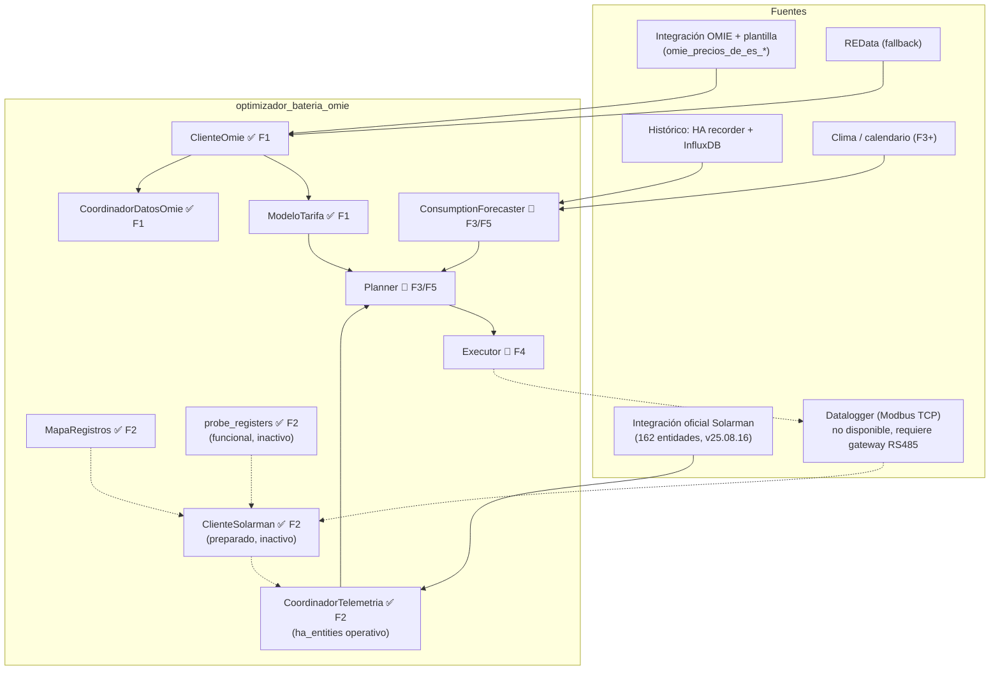
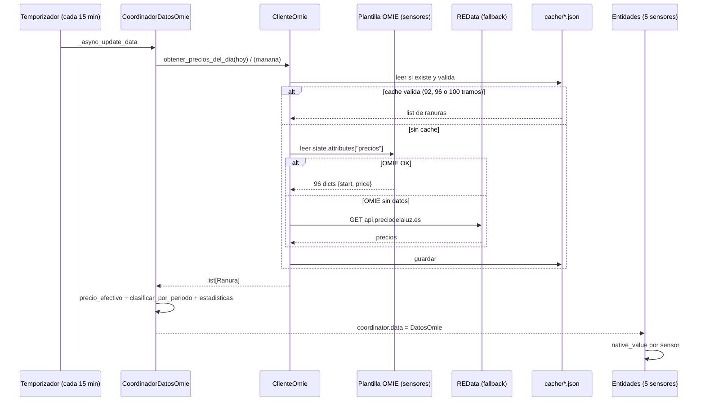
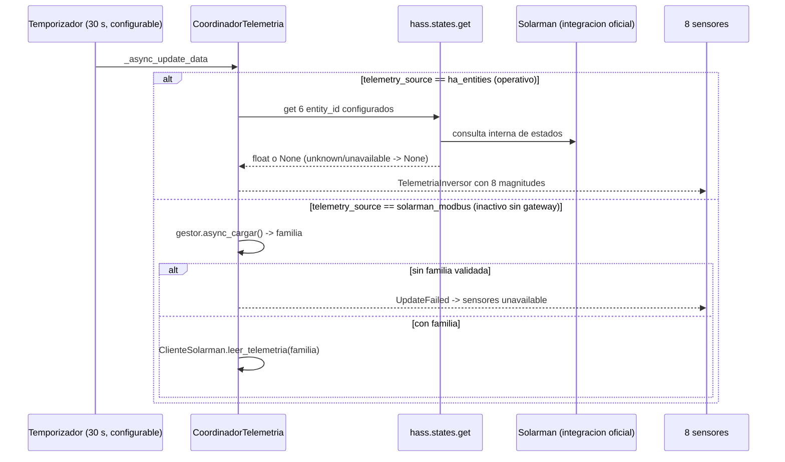
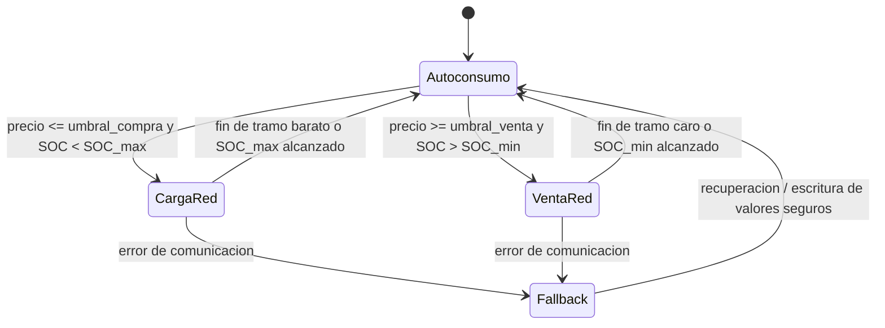

# Diseño y Especificación — `optimizador_bateria_omie`

**Custom component de Home Assistant** para optimizar carga/descarga de batería (inversor Deye vía datalogger Solarman) con precios del mercado eléctrico español en tramos de 15 minutos (OMIE) y predicción de consumo del hogar.

> **Estado del documento** (octubre 2026, v0.9.0). Este documento es la **fuente única de verdad** del proyecto.
>
> - **F1** — Precios: ✅ **implementada y en producción doméstica** (manifest 0.7.3).
> - **F2** — Telemetría: ✅ **completada** (manifest **0.8.10**). Vía operativa: **`ha_entities`** (integración oficial Solarman). `solarman_modbus` queda preparado pero inactivo por limitación de hardware del datalogger.
> - **F3** — Predicción v1 + planificador greedy: ✅ **completada** (manifest **0.9.0**): perfil estadístico del recorder + **Solcast como fuente preferente de FV** (perfil como fallback por día) + plan greedy en `dry_run` (sin escrituras).
> - **F4** a **F6** — 🚧 diseño, no implementadas.>
> Cada apartado lleva la marca **✅ F1**, **✅ F2**, **🚧 Fn** según corresponda.

---

## 1. Visión general

El componente se ejecuta dentro de Home Assistant y, en su versión completa (F1–F6), hará lo siguiente:

1. **Obtener los precios del mercado diario OMIE con resolución de 15 minutos** (MTU15, operativo en España desde el 1 de octubre de 2025). ✅ F1
2. **Leer el estado del inversor Deye**: SOC, potencias de carga/descarga, consumo de casa, producción FV, **temperatura del inversor y de la batería**. ✅ F2 (vía entidades de la integración oficial Solarman; `solarman_modbus` preparado como alternativa).
3. **Predecir el consumo** con histórico (HA recorder + InfluxDB) + calendario + clima. ✅ F3 (capa 1: perfil estadístico; Solcast para FV) 🚧 F5 (ML + clima)
4. **Calcular un plan horario por tramos de 15 min** que prioriza el autoconsumo y aplica arbitraje. ✅ F3 (greedy en `dry_run`) 🚧 F5 (LP)
5. **Aplicar el plan escribiendo** en el inversor con salvaguardas (dry-run, write-verify, watchdog, fallback). 🚧 F4

Prioridad de estrategia: **autoconsumo + arbitraje cuando convenga**.

**Estado actual**:
- **F1 en producción**: precios OMIE, precio efectivo 2.0TD, clasificación por período tarifario y estadísticas en 5 sensores (se añadió `SensorPreciosEfectivosHoy` como curva completa).
- **F2 completada**: telemetría de 8 sensores (SOC, potencia, corriente, consumo, FV, temperatura inversor, temperatura batería, familia validada) leyendo de la integración Solarman vía `ha_entities`. La vía `solarman_modbus` está implementada y probada pero **no es operativa** con el datalogger actual (ver §5.3 y §12.2).
- **F3 completada (0.9.0)**: predicción de consumo por perfil estadístico del recorder (p10/p50/p90 por tramo × tipo de día), previsión FV con **Solcast preferente** y fallback por día al perfil, planificador greedy en `dry_run` (sin escrituras), sensores `prediccion_consumo` / `plan` / `ahorro_estimado_hoy`, `switch.festivo_hoy`, servicio `regenerate_plan` y todos los parámetros editables por `reconfigure`. En **revisión manual de 1 semana** antes de F4.

---

## 2. Contexto del sistema existente

| Elemento | Detalle |
|---|---|
| Plataforma | Home Assistant Yellow (HAOS), en uso desde ~2023 |
| Python / HA | Python **3.14**, Home Assistant **2026.10.1** |
| Inversor | **Deye SUN-6K-SG05LP1-EU-AM2-P** — híbrido monofásico, 6.000 W, PV máx. 7.800 W, batería 40–60 V, corriente máx. carga/descarga **0–135 A** |
| Batería | **Docan 51,2 V 300 Ah LiFePO4** — **15,36 kWh nominales**; 140 A recomendados, 135 A límite del inversor (≈ 6,9 kW) |
| Datalogger | Solarman serie **3178171873**, IP fija **192.168.1.76**, puerto 8899 |
| **Integración Solarman** | Instalada y operativa (v25.08.16) — publica **162 entidades** (`sensor.inversor_*`). Fuente de telemetría de F2 vía `ha_entities` |
| Históricos | **HA recorder** (reciente) + **InfluxDB** (anterior) — ambos intactos, disponibles para F3 |
| **Fuente de precios** | Integración oficial OMIE + plantilla `precios_omie.yaml` (§5.1) |
| Clima | Integración weather de HA (pendiente de confirmar en F3) |
| Tarifa | Indexada **2.0TD** con **5,75 kW contratados**; peajes y cargos en §5.6 |
| Remuneración excedentes | **Al mismo precio que la compra** (contrato con mayorista) |

**Limitación confirmada del datalogger** (F2): el datalogger serie `3178171873` **no expone Modbus TCP local**. Los puertos 8899 y 502 están cerrados al protocolo Modbus, aunque la IP responde a ping. La integración oficial Solarman usa un protocolo propietario que sí funciona. Para usar `solarman_modbus` en el futuro se requerirá un **gateway RS485→TCP** externo (Elfin EW11 o similar) — ver §12.2.

---

## 3. Requisitos funcionales

### RF-01 — Precios OMIE a 15 minutos ✅ F1

- Precios del mercado diario español (MDA) con resolución de **15 minutos** para hoy y mañana, en €/kWh.
- Fuentes en cascada:
  1. **Sensores de plantilla** `sensor.omie_precios_de_es_{ayer,hoy,manana}`, creados con `omie.get_prices_for_date` (§5.1).
  2. **REData** (`https://api.preciodelaluz.es/v1/prices?date=...`) como fallback.
- **Caché en disco** por día (`cache/YYYY-MM-DD.json`), validada a **92, 96 o 100 tramos** (días DST).
- **Refresco**: coordinador cada 15 min + triggers de la plantilla (13:35 y 00:05 CET) + arranque HA.
- **Expuesto**: precio del tramo actual, precio efectivo, clasificación por **período 2.0TD** (valle/llano/punta) y estadísticas (mín/máx/mediana) + curva completa de precios efectivos del día.

> **Deuda técnica** (§12.3): #1 limpieza de caché, #2 backoff/timeout REData y #7 log con tramos mañana **resueltas en F2**; #3 (cliente directo `api.omie.es`) **condicionada** a endpoint de 15 min.

### RF-02 — Telemetría del inversor ✅ F2

- **Vía operativa: `ha_entities`** — lectura de las entidades que publica la integración oficial Solarman mediante `hass.states.get()`. Sin conexión Modbus directa, sin conflictos con la integración ya instalada.
- **8 sensores publicados**:
  - `soc_bateria` (%)
  - `potencia_bateria` (W, **+descarga/−carga** — convención Deye **confirmada empíricamente** contra `sensor.inversor_battery_power`)
  - `corriente_bateria` (A) — `None` en modo `ha_entities` (Solarman no la expone de forma fiable; disponible cuando se active `solarman_modbus`)
  - `consumo_casa` (W)
  - `produccion_fv` (W)
  - **`temperatura_inversor` (°C)** — usada por automatización del ventilador externo
  - **`temperatura_bateria` (°C)**
  - `familia_validada` (diagnóstico) — siempre `ninguna` en `ha_entities`
- **Refresco**: 30 s configurable (10–300 s).
- **Vía preparada: `solarman_modbus`** — implementada en `ClienteSolarman` con `pysolarmanv5`, `MapaRegistros` de dos familias (A/B), `probe_registers` con tolerancia ±2 %, plausibilidad y reset. **No operativa** hasta disponer de gateway RS485 (§12.2).
- **F2 es estrictamente de solo lectura**: no existe método `escribir_registros` en el cliente.

### RF-03 — Control de carga/descarga 🚧 F4

- Servicios para ajustar corriente/potencia de carga y descarga, SOC objetivo, SOC mínimo, carga desde red y venta a red.
- **Mapa de registros configurable** en `registers.yaml` (nunca en código). `probe_registers` valida familia antes de permitir escrituras.
- Límite de seguridad: **máx N escrituras por hora** (default 12) + **write-verify** tras cada escritura.

### RF-04 — Compra/venta con parámetros ajustables 🚧 F4/F5

- **Comprar** (cargar desde red) cuando el precio proyectado esté bajo el umbral y bajo el precio medio ponderado de descarga esperada. Coste valorado con **precio efectivo** (spot + peajes/cargos + impuestos).
- **Vender** (verter a red) cuando el precio supere el umbral y compense la eficiencia round-trip: `p_venta ≥ p_compra_efectiva / η_round_trip + margen`. Venta al mismo precio que la compra (§5.6).
- **Restricción dura**: importación total (consumo + carga batería) ≤ **5,75 kW**.
- Todos los umbrales como entidades `number`/`switch` modificables sin reiniciar.

### RF-05 — Predicción de consumo ✅ F3 (capa 1) 🚧 F5 (ML)

- Predicción de consumo por tramos de 15 min para hoy + mañana.
- **Fuentes de histórico disponibles**:
  - **HA recorder**: datos recientes (últimos días/semanas). ✅ **Usado en F3** (`historico.py` + `FuenteHistoricoRecorder`, ventana configurable 7–90 días, default 28).
  - **InfluxDB**: histórico completo (años) — **TODO documentado**, no consultado en F3 (decisión D4 del PLAN_F3).
- Features del modelo: `tramo_dia`, `dia_semana`, `es_festivo`, `es_vacaciones`, `temperatura_media`, `irradiancia`, `consumo_mismo_tramo_{7,14,21,28}d`.
- Implementación por capas:
  1. **F3** ✅: perfil estadístico (mediana p50 por tramo × tipo de día con banda p10–p90; cascada tipo → opuesto → global → `None` sin inventar valores).
  2. **F5**: ML (Gradient Boosting / LightGBM con scikit-learn).
- **Previsión FV (F3)** ✅: **Solcast PV Forecast como fuente preferente** (`detailedForecast` de las entidades de hoy y mañana, mapeo 30→15 min por repetición, kWh/periodo → W) con **fallback por día al perfil estadístico**; fuente expuesta como atributo `fuente_fv`.
- Salida: `{p50, p10, p90}` en W. Banda p10-p90 para el planner conservador.

### RF-06 — Planificador y ejecutor ✅ F3 (greedy dry-run) 🚧 F4 (executor) / F5 (LP)

- Plan por tramos de 15 min: `AUTOCONSUMO` / `CARGA_RED` / `VENTA_RED` / `MANTENER`, potencia objetivo, SOC previsto, beneficio marginal estimado.
- **F3** ✅: planner greedy en `dry_run` (`planificador.py` + `coordinador_plan.py` + `sensor.plan` + `sensor.ahorro_estimado_hoy` + `switch.festivo_hoy` + servicio `regenerate_plan`). **Sin escrituras al inversor**.
- **F4**: executor con write-verify, límite de escrituras, watchdog y fallback.
- **F5**: LP con PuLP/SciPy.
- Recalcula ante: precios nuevos, cambio de parámetros (reconfigure recarga la entrada, aplicación inmediata), cambio de tramo (15 min), desviación >10 % entre SOC real y previsto, o festivo manual.

---

## 4. Arquitectura

### 4.1 Diagrama de componentes (F1 + F2 + F3+)



**Línea continua** = operativa en F2. **Línea discontinua** = preparada pero inactiva hasta gateway RS485.

### 4.2 Ciclo de actualización de precios ✅ F1



### 4.3 Ciclo de telemetría ✅ F2



### 4.4 Máquina de estados de la batería (F4+, referencia)



---

## 5. Módulos del componente

### 5.1 `ClienteOmie` ✅ F1

Fichero: `custom_components/optimizador_bateria_omie/cliente_omie.py`.

**Clases públicas**:
- `ConfiguracionOmie(fuente_prioritaria, usar_cache, dias_cache)`.
- `Ranura(fecha_hora_utc, precio_eur_kwh, fuente, fecha_publicacion, fecha_hora_fin_utc)`.
- `ErrorFuenteOmie`, `ErrorIntegracionNoDisponible`.
- `ClienteOmie(hass, config)`.

**Métodos**:

| Método | Descripción |
|---|---|
| `_obtener_desde_integracion_omie(fecha)` | Localiza `sensor.omie_precios_de_es_{ayer,hoy,manana}` por fecha **local** y devuelve `state.attributes["precios"]` (`list[dict]` con `{start, price}`). Devuelve `[]` si no hay datos. |
| `_obtener_desde_redata(fecha)` | HTTP GET a `api.preciodelaluz.es`. `ClientTimeout(total=10)` + 2 reintentos (0,5 s / 2 s). |
| `_normalizar_a_15min(datos, fecha)` | Convierte `list[dict]` a `list[Ranura]`. Solo formato OMIE `{start, end, price}` con timezone. |
| `obtener_precios_del_dia(fecha)` | Caché → OMIE → REData → normalización → persistir caché. Lanza `ErrorFuenteOmie` si todas fallan. |
| `limpiar_cache_antigua(dias)` | Borra `cache/*.json` con `mtime > dias * 86400`, en executor. Idempotente. Arranque + job diario 04:30. |

**Decisiones de diseño de F1** (sin cambios):

| Aspecto | Decisión |
|---|---|
| Fuente primaria | Sensores de plantilla OMIE (integración oficial) |
| Fuente de fallback | Solo REData |
| Formatos soportados | **Solo** `{start, end, price}` |
| Relleno a 96 ranuras | **No** se rellena con ceros |
| Caché | Válida si tiene **92, 96 o 100 ranuras** (DST) |
| Zona horaria | Selección de sensor por **fecha local** |

**Plantilla externa requerida** (`precios_omie.yaml`): tres sensores `omie_precios_de_es_{ayer,hoy,manana}` alimentados por `omie.get_prices_for_date` con triggers a las 13:35 y 00:05.

**F2+**: `_obtener_desde_api_omie()` sigue **opcional** y solo si existe endpoint de 15 min.

### 5.2 `ClienteSolarman` y `CoordinadorTelemetria` ✅ F2

**Estado**: implementados, probados y **operativos en modo `ha_entities`**. El modo `solarman_modbus` está implementado pero **inactivo** por limitación de hardware del datalogger (§2, §12.2).

**`CoordinadorTelemetria`**:
- Intervalo configurable (`intervalo_telemetria_s`, default 30, rango 10–300).
- `_async_update_data()` ramifica según `telemetry_source`:
  - **`ha_entities`** (operativo): `_leer_de_ha_entities()` consulta `hass.states.get()` para los 6 `entity_id` configurados. Valores `unknown`/`unavailable` → `None` (nunca se inventan). Devuelve `TelemetriaInversor`.
  - **`solarman_modbus`** (preparado): `UpdateFailed` **antes** de tocar Modbus si no hay familia validada (evita conexiones inútiles). Con familia → `ClienteSolarman.leer_telemetria(familia)`.
- `TelemetriaInversor` (dataclass):
  - `soc`, `potencia_bateria` (**+descarga/−carga**, Deye), `corriente_bateria`, `consumo_casa`, `produccion_fv`, **`temperatura_inversor`**, **`temperatura_bateria`**, `ts_actualizacion`.

**`ClienteSolarman`** (preparado para cuando haya gateway):
- `PySolarmanV5` síncrono en executor, sin `connect()` (D17).
- Backoff acotado M4 (3 intentos, 0,5/2/5 s).
- Troceado ≤ `block_size` (16).
- `leer_telemetria(familia)` con familia por parámetro (C4).
- **No incluye `escribir_registros`** (reservado a F4).

**`MapaRegistros`**:
- Carga `registers.yaml` con override de usuario en `config/optimizador_bateria_omie/`.
- **Soporta `offset`** (necesario para las temperaturas Deye: `valor - 1000`).
- Two's complement 16-bit (`signed: true`) + `invertir_signo` (por defecto `false`, Deye nativo).
- `parametros()` aplica `offset` antes de `scale`.

**`GestorValidacion`**: persistencia en `hass.storage.Store` (`optimizador_bateria_omie/probe.json`) con `{familia, probe_addr, probe_funcion, ultima_validacion_ts}`. Revalidación al arrancar si `probe_addr` cambió.

### 5.2.2 Modificaciones aplicadas en F2 (M1–M16)

| # | Modificación | Estado |
|---|---|---|
| C3 | Signo Deye (+descarga/−carga) con `invertir_signo` | ✅ Confirmado empíricamente |
| C4 | `leer_telemetria(familia)` con familia por parámetro | ✅ |
| C5 | `UpdateFailed` antes de Modbus sin familia | ✅ |
| M1 | Tolerancia ±2 % en `probe_registers` | ✅ |
| M2 | Plausibilidad parametrizada en `registers.yaml` | ✅ |
| M3 | `reset: true` borra validación | ✅ |
| M4 | Backoff 3 intentos / 5 s | ✅ |
| M5 | Limpieza caché arranque + job 04:30 | ✅ |
| M6 | `async_step_reconfigure` | ✅ |
| M7 | `register` opcional, `familia` opcional | ✅ |
| M8 | Two's complement con test de valor negativo | ✅ |
| M9 | `supports_response=SupportsResponse.OPTIONAL` | ✅ |
| M10 | Sensor diagnóstico `familia_validada` | ✅ |
| M11 | `SensorCorrienteBateria` | ✅ |
| M12 | `InversorFake` con `connect()`/`disconnect()` | ✅ |
| M13 | `pysolarmanv5>=3.0.6,<4.0.0` en requirements | ✅ |
| M14 | Override `registers.yaml` en config usuario | ✅ |
| **M15** | **`ha_entities` como vía operativa; `solarman_modbus` inactivo** | ✅ |
| **M16** | **`offset` en `MapaRegistros` para temperaturas Deye** | ✅ |

### 5.3 `registers.yaml` y familias Deye ⚠️ (preparado, inactivo)

**Estado**: el fichero existe, está validado por `MapaRegistros`, y el mapa de **familia estándar** está confirmado contra los manuales `Deye sunsynk modbus.pdf` y `Deye.Modbus.protocol.V118.pdf`:

| Magnitud | Registro | Escala | Notas |
|---|---|---|---|
| SOC | 184 | 1 % | — |
| Potencia batería | 190 | 1 W | `signed` (+descarga/−carga) |
| Corriente batería | 191 | 0,01 A | `signed` |
| Voltaje batería | 183 | 0,01 V | — |
| Temperatura inversor | 90 | 0,1 °C | **offset 1000** |
| Temperatura batería | 182 | 0,1 °C | **offset 1000** |
| Consumo casa | 178 | 1 W | `signed` |
| Producción FV | 186 | 1 W | — |

**No se usa operativamente** porque el datalogger no expone Modbus TCP. Queda preparado para cuando se instale un gateway RS485 (§12.2).

Contenido del `registers.yaml` empaquetado:

```yaml
inverter: "deye-sun-6k-sg05lp1-am2"
block_size: 16
familias:
  estandar:
    probe:  { funcion: soc, addr: 184 }
    plausibility:
      soc:          [0, 100]
      potencia_bat: [-7000, 7000]
    telemetria:
      soc:                  { addr: 184, scale: 1,    unit: "%" }
      potencia_bat:         { addr: 190, scale: 1,    unit: "W",  signed: true, invertir_signo: false, signo_semantico: "+descarga/-carga" }
      corriente_bat:        { addr: 191, scale: 0.01, unit: "A",  signed: true }
      voltaje_bat:          { addr: 183, scale: 0.01, unit: "V" }
      temperatura_inversor: { addr: 90,  scale: 0.1,  unit: "°C", offset: 1000 }
      temperatura_bateria:  { addr: 182, scale: 0.1,  unit: "°C", offset: 1000 }
      consumo_casa:         { addr: 178, scale: 1,    unit: "W",  signed: true }
      produccion_fv:        { addr: 186, scale: 1,    unit: "W" }
    control:  # reservado a F4; ningun codigo de F2 lo invoca
      corriente_carga: { addr: 128, min: 0, max: 135 }
      carga_desde_red: { addr: 166 }
      limite_carga:    { addr: 172, min: 10, max: 100 }
      limite_descarga: { addr: 108, min: 10, max: 100 }
```

### 5.4 `ConsumptionForecaster` 🚧 F3/F5

- **Histórico disponible**: HA recorder (reciente) + InfluxDB (histórico largo).
- Entrenamiento semanal. Features según RF-05.
- Salida `{p50, p10, p90}` en W.
- F3: perfil estadístico. F5: ML con scikit-learn.

### 5.5 `Planner` 🚧 F3/F5

- F3: greedy con reglas heurísticas en `dry_run`.
- F5: LP con PuLP/SciPy, restricción importación ≤ 5,75 kW.
- Sensor `ahorro_hoy` con `coste_sin_plan` vs `coste_con_plan`.

### 5.6 `ModeloTarifa` ✅ F1

Fichero: `custom_components/optimizador_bateria_omie/tarifa.py`.

**Clases públicas**:
- `ConfiguracionTarifa(potencia_contratada_kw=5.75, impuesto_electrico_pct=0.051127, iva_pct=0.21, aplicar_impuestos_precio=True)`.
- `PeriodoTarifa` (`es_punta`, `es_llano`, `es_valle` sobre hora local).
- `ModeloTarifa(config)`.

**Cargos por energía**:

| Período | Días | Horas locales | Peaje €/kWh | Cargo €/kWh | **Total €/kWh** |
|---|---|---|---|---|---|
| Punta | L–V | 10:00–14:00 y 18:00–22:00 | 0,033261 | 0,064292 | **0,097553** |
| Llano | L–V | 08:00–10:00, 14:00–18:00 y 22:00–24:00 | 0,016409 | 0,012858 | **0,029267** |
| Valle | L–V | 00:00–08:00 | 0,000077 | 0,003215 | **0,003292** |
| Valle | S–D y festivos nacionales | 00:00–24:00 | 0,000077 | 0,003215 | **0,003292** |

**Fórmula**:

```
precio_compra_efectivo(tramo) = (spot_15min + peaje + cargo) × (1 + IE) × (1 + IVA)
```

IE = 5,1127 %, IVA = 21 %.

**Clasificación**: `clasificar_por_periodo` (período 2.0TD real). `clasificar_por_percentiles` queda como utilidad auxiliar para el planner (F3+). Fines de semana y festivos → `valle`. Hora local (CET/CEST automático).

**Peajes/cargos/impuestos siguen hardcodeados en `tarifa.py`** — mover a `entry.data` es deuda #5 (F4).

### 5.7 `CoordinadorDatosOmie` ✅ F1

Fichero: `custom_components/optimizador_bateria_omie/coordinador.py`.

**Dataclass `DatosOmie`**: `precios_hoy`, `precios_manana`, `clasificaciones_hoy`, `clasificaciones_manana`, `estadisticas_hoy`, `estadisticas_manana`, `fuente`, `ts_actualizacion`.

**Método principal**: `async _async_update_data() -> DatosOmie`. `update_interval = 15 min`. Devuelve `self._datos` en éxito; lanza `UpdateFailed` en fallo.

**Métodos públicos**:
- `obtener_precio_actual() -> float | None`.
- `obtener_precio_efectivo_actual() -> float | None`.
- `obtener_clasificacion_actual() -> str | None` (índice calculado desde `precios_hoy[0]`).
- `obtener_estadisticas_actual() -> dict`.
- `_buscar_ranura(ranuras, ahora)`: helper en UTC, con fallback a `precios_manana` en la madrugada local.

Log de éxito (F2): `Datos actualizados. Fuente: X, tramos hoy: N, tramos mañana: M`.

### 5.8 `entidades.py` y `entidades_solarman.py` ✅ F1 + ✅ F2

**F1** (`entidades.py`): `SensorBase(CoordinatorEntity, SensorEntity)` + 5 sensores de precio.

**F2** (`entidades_solarman.py`): `SensorTelemetriaBase(CoordinatorEntity, SensorEntity)` + **8 sensores**:

| Clase | `unique_id` | Unidad | `device_class` | `state_class` |
|---|---|---|---|---|
| `SensorSocBateria` | `..._soc_bateria` | % | `battery` | `measurement` |
| `SensorPotenciaBateria` | `..._potencia_bateria` | W | `power` | `measurement` |
| `SensorCorrienteBateria` | `..._corriente_bateria` | A | `current` | `measurement` |
| `SensorConsumoCasa` | `..._consumo_casa` | W | `power` | `measurement` |
| `SensorProduccionFv` | `..._produccion_fv` | W | `power` | `measurement` |
| **`SensorTemperaturaInversor`** | `..._temperatura_inversor` | °C | `temperature` | `measurement` |
| **`SensorTemperaturaBateria`** | `..._temperatura_bateria` | °C | `temperature` | `measurement` |
| `SensorFamiliaValidada` | `..._familia_validada` | — | — | `DIAGNOSTIC` |

> ⚠️ **Bug de F2 resuelto**: las clases de temperatura heredaban por error de `SensorBase` (importado de `entidades.py`) en lugar de `SensorTelemetriaBase`, causando `NameError` al importar el módulo. Corregido: todas heredan de `SensorTelemetriaBase`.

### 5.9 `sensor.py` ✅ F1 + ✅ F2

- F1: crea `ClienteOmie` + `CoordinadorDatosOmie` + 5 entidades de precio.
- F2: lee `entry.data` (con defaults vía `entry.data.get`), instancia `MapaRegistros` + `GestorValidacion` + `CoordinadorTelemetria`. `ClienteSolarman` solo si `telemetry_source == solarman_modbus` (siempre `None` en `ha_entities`). Añade las 8 entidades de telemetría.

### 5.10 `config_flow.py` ✅ F1 + ✅ F2

- F1: 3 campos + `_abort_if_unique_id_configured()`.
- F2: campos nuevos (`ip`, `puerto`, `serie`, `telemetry_source`, `intervalo_telemetria_s`, 6 `entity_id`). `async_step_reconfigure` para editar sin recrear.
- **`VERSION = 1`** (sin migración desde F1; `entry.data.get` con defaults).

---

## 6. Entidades y servicios de Home Assistant

### 6.1 Entidades F1 ✅

Los `entity_id` dependen del `device_info`. En la instalación de referencia: `sensor.inversor_optimizador_bateria_omie_*`. Los `unique_id` son estables.

| Entidad | Estado | Atributos |
|---|---|---|
| `precio_actual` | Precio del tramo (€/kWh, 4 dec.) | `fuente`: `omie` / `redata` / `desconocida` |
| `precio_efectivo` | `(spot + peaje + cargo) × (1+IE) × (1+IVA)` | — |
| `precio_clasificacion` | `valle` / `llano` / `punta` (por período 2.0TD) | — |
| `precio_estadisticas` | Mediana del día (€/kWh) | `min`, `max`, `mediana`, `fuente`, `ts_actualizacion` |
| `precios_efectivos_hoy` | Mediana + curva completa | `precios_ordenados` |

### 6.2 Entidades F2 ✅

8 sensores listados en §5.8. En modo `ha_entities`:
- Todos publican datos **excepto `corriente_bateria`** (siempre `None`, `unavailable`).
- `familia_validada` siempre muestra `ninguna` (diagnóstico inactivo).

### 6.3 Entidades planificadas 🚧 F3–F5

| Entidad | Tipo | Fase |
|---|---|---|
| `sensor.*_prediccion_consumo` | W + curva p10/p50/p90 | F3 |
| `sensor.*_plan` | acción y potencia del tramo actual | F3 |
| `sensor.*_ahorro_hoy` | € ahorrados | F5 |
| `sensor.*_forecast_quality` | MAPE del backtest | F5 |
| `switch.*_activo` | habilita escritura | F4 |
| `switch.*_permitir_carga_red` | arbitraje de compra | F4 |
| `switch.*_permitir_venta_red` | arbitraje de venta | F4 |
| `switch.*_festivo_hoy` | marca manual festivo/vacaciones | F3 |
| `number.*_precio_max_compra` | umbral de compra | F4 |
| `number.*_precio_min_venta` | umbral de venta | F4 |
| `number.*_margen_arbitraje` | margen mínimo | F4 |
| `number.*_soc_min` / `_soc_max` | límites SOC | F4 |
| `number.*_potencia_max_carga` / `_descarga` | límites potencia | F4 |
| `number.*_potencia_max_red` | potencia contratada | F4 |
| `number.*_eficiencia_round_trip` | 70–95 % | F4 |

### 6.4 Servicios

**F2 ✅ — `optimizador_bateria_omie.probe_registers`**

- Registrado con `supports_response=SupportsResponse.OPTIONAL`.
- Campos: `expected` (req), `register` (opt), `familia` (opt), `reset` (bool, default false).
- **Funcional** pero **inactivo en modo `ha_entities`** (no toca Modbus). Listo para cuando se active `solarman_modbus`.
- Respuesta JSON con `{reset, familias: {A: {...}, B: {...}}, familia_activa}`.

**F3/F4 🚧** (referencia): `regenerate_plan`, `force_mode`, `release_manual`.

---

## 7. Parámetros ajustables

### 7.1 Config flow actual ✅ F1 + ✅ F2

| Parámetro | Tipo | Default | Valores |
|---|---|---|---|
| `fuente_prioritaria` | selección | `omie` | `omie`, `redata` |
| `usar_cache` | bool | `true` | — |
| `dias_cache` | int | `7` | 1–30 |
| `telemetry_source` | selección | **`ha_entities`** | `ha_entities`, `solarman_modbus` |
| `ip` / `puerto` / `serie` | str/int | datalogger | editables |
| `intervalo_telemetria_s` | int | `30` | 10–300 |
| `entity_id_soc_bateria` … `entity_id_temp_bateria` | str | vacío | solo con `ha_entities` |

**Sin `OptionsFlow`** (deuda #4 absorbida por `reconfigure`).

### 7.2 Modelo de tarifa ✅ F1 (hardcodeado)

Peajes, cargos, impuestos y potencia contratada en `tarifa.py`. **Deuda #5 (F4)**: mover a `entry.data`.

### 7.3 Esquema completo planificado 🚧

Sin cambios respecto a versiones anteriores.

---

## 8. Fases de implementación

| Fase | Alcance | Estado | Criterio de salida |
|---|---|---|---|
| **F1 — Precios** | `ClienteOmie` + `ModeloTarifa` + `CoordinadorDatosOmie` + 5 sensores + config flow | ✅ **completada** (0.7.3) | Precios coinciden con `sensor.omie_precios_de_es_hoy`; clasificación 2.0TD correcta; precio efectivo validado |
| **F2 — Telemetría** | `ClienteSolarman` (preparado) + `MapaRegistros` + `registers.yaml` + `CoordinadorTelemetria` (`ha_entities` operativo) + `probe_registers` + **8 sensores** + deuda F1 (#1, #2, #7) | ✅ **completada** (0.8.10) | SOC, potencia y **temperaturas** operativos vía `ha_entities`; convención Deye confirmada; automatización del ventilador funcionando; suite de tests + `ruff` limpios |
| **F3 — Predicción v1 + Planner greedy** | `historico.py` + `predictor_consumo.py` (perfil recorder + Solcast preferente con fallback por día) + `planificador.py` (greedy) + `coordinador_plan.py` + 3 sensores (`prediccion_consumo`, `plan`, `ahorro_estimado_hoy`) + `switch.festivo_hoy` + servicio `regenerate_plan` + reconfigure ampliado | ✅ **completada** (0.9.0) | Plan diario plausible 1 semana en `dry_run` (revisión manual en curso) |
| **F4 — Control** | Executor con write-verify, límite escrituras, fallback, watchdog. **Requiere gateway RS485** para `solarman_modbus` | 🚧 pendiente | 1 semana sin errores; escrituras verificadas |
| **F5 — ML + LP** | Forecaster ML + LP + banda p90 + auditoría + reentrenamiento | 🚧 pendiente | MAPE < 20 %; ahorro real medible |
| **F6 — Pulido** | Dashboard, notificaciones, informes | 🚧 pendiente | 30 días sin intervención |

**Nota F2 → F3**: F3 no depende de `solarman_modbus`. Históricos en HA recorder + InfluxDB, precios en F1, telemetría actual en `ha_entities`. **F3 puede avanzar sin bloqueos**.

---

## 9. Seguridad y resiliencia

### 9.1 Principios no negociables

- `dry_run` por defecto `true` (F4+): plan publicado pero nunca escrito hasta validación explícita.
- **Write-verify**: relectura tras cada escritura; 3 fallos consecutivos → `fallback` + bloqueo hasta intervención.
- **Escrituras bloqueadas hasta validación de familia** (F2+).
- **Nunca permitir**: SOC < límite de descarga, corrientes > límites del `registers.yaml`, escrituras con alarma/fault.
- **Guard de potencia contratada**: importación ≤ 5,75 kW; si supera 95 %, reducir corriente de carga.
- **Sin datos → no inventar**: si no hay precios, plan con lo disponible; si no hay telemetría, sensores `unavailable`.
- **Auditoría inmutable** (JSONL) de planes, escrituras y errores.

### 9.2 Aplicación en F1 ✅ y F2 ✅

F1:
- Coordinador sin escrituras.
- `UpdateFailed` si todas las fuentes fallan.
- Caché validada a 92/96/100 tramos.

F2:
- **Lectura pasiva** en `ha_entities` (sin tocar datalogger).
- **Sin escrituras** en `ClienteSolarman` (no existe `escribir_registros`).
- `unknown`/`unavailable` → `None` (nunca valores inventados).

---

## 10. Pruebas

### 10.1 F1 ✅ (62 tests en verde)

- `test_normalizar_a_15min.py`
- `test_cliente_omie.py`
- `test_tarifa.py`
- `test_coordinador.py`

### 10.2 F2 ✅ (implementados)

- `tests/fake_inversor.py` — `InversorFake` con `connect()`/`disconnect()`, `read_holding_registers`, `write_multiple_holding_registers`, inyección de fallos.
- `tests/test_mapa_registros.py` — YAML válido/inválido, override de usuario, `block_size ≤ 16`, two's complement, **`offset` (temperaturas)**, `invertir_signo`.
- `tests/test_solarman_client.py` — familia por parámetro, troceado ≤16, semáforo, backoff acotado, signed con valor negativo, sin `connect()`.
- `tests/test_telemetria.py` — `ha_entities` con `hass.states` mock, `UpdateFailed` sin familia, delegación con familia.
- `tests/test_probe_registers.py` — tolerancia ±2 %, plausibilidad, reset, persistencia.
- `tests/test_mantenimiento.py` — limpieza de caché (arranque + job), backoff REData.
- Tests de `reconfigure`.

### 10.3 F3+ 🚧

- `test_planner.py`: escenarios valle/punta, precio negativo, SOC 0/50/100, venta deshabilitada, restricción 5,75 kW.
- `test_forecaster.py`: dataset sintético, backtesting con seed fija.

---

## 11. Estructura del repositorio (post-F2)

```
optimizador-bateria-omie/
├── custom_components/
│   └── optimizador_bateria_omie/
│       ├── __init__.py              # setup entry + job caché + probe service
│       ├── manifest.json            # versión 0.8.10+
│       ├── const.py                 # DOMAIN, defaults, CONF_*, unique_ids
│       ├── config_flow.py           # ConfigFlow + reconfigure
│       ├── cliente_omie.py          # F1 + deuda #1, #2
│       ├── tarifa.py                # F1 (hardcoded)
│       ├── coordinador.py           # F1 + log deuda #7
│       ├── entidades.py             # F1: SensorBase + 5 sensores
│       ├── entidades_solarman.py    # F2: SensorTelemetriaBase + 8 sensores
│       ├── sensor.py                # setup de plataforma (F1 + F2)
│       ├── mapa_registros.py        # F2 (soporta offset)
│       ├── solarman_client.py       # F2 (preparado, inactivo)
│       ├── telemetria.py            # F2: TelemetriaInversor + GestorValidacion + CoordinadorTelemetria
│       ├── services.py              # F2: probe_registers
│       ├── services.yaml            # F2 (clave raíz SIN dominio)
│       ├── strings.json             # JSON puro (sin comentarios)
│       ├── translations/
│       │   └── es.json              # JSON puro
│       ├── registers.yaml           # F2 (familia estándar)
│       ├── cache/                   # runtime
│       └── tests/
│           └── (F1 + F2)
├── hacs.json
├── README.md
├── SPEC.md                          # este documento
└── docs/
    ├── INSTALACION.md
    ├── PLAN_F2.md                   # cerrado
    └── RESULTADO_F2.md              # (a crear)
```

**`manifest.json` final**:

```json
{
  "domain": "optimizador_bateria_omie",
  "name": "Optimizador Batería OMIE",
  "documentation": "https://github.com/acarrilloa/optimizador-bateria-omie",
  "issue_tracker": "https://github.com/acarrilloa/optimizador-bateria-omie/issues",
  "codeowners": ["@acarrilloa"],
  "config_flow": true,
  "version": "0.8.10",
  "requirements": ["pysolarmanv5>=3.0.6,<4.0.0"],
  "dependencies": ["omie"],
  "iot_class": "local_polling",
  "homeassistant": "2026.10.1",
  "license": "MIT"
}
```

**Paquetes**: solo `pysolarmanv5`. **NO** `voluptuous` ni `PyYAML` (vienen con HA Core).

**Convención de nombres**:
- Ficheros y clases en **español**.
- `unique_id` con prefijo `optimizador_bateria_omie_`.
- `entity_id` derivado del `device_info`: `sensor.inversor_optimizador_bateria_omie_*`.

**Ficheros** (convención española de §11, decisión D1 del PLAN_F3): F1/F2 según arriba; F3: `historico.py`, `predictor_consumo.py`, `planificador.py`, `coordinador_plan.py`, `entidades_plan.py`, `switch.py`. **Futuro** (F4+): `executor.py`.

---

## 12. Datos pendientes y deuda técnica

### 12.1 Confirmados

- Inversor Deye SUN-6K-SG05LP1-EU-AM2-P.
- Batería Docan 51,2 V 300 Ah (15,36 kWh).
- Datalogger Solarman serie 3178171873 (Modbus TCP **no disponible**).
- Tarifa 2.0TD con 5,75 kW contratados.
- Remuneración simétrica.
- Fines de semana y festivos nacionales → **valle**.
- **Convención Deye `+descarga/−carga`** verificada empíricamente contra `sensor.inversor_battery_power`.
- **Telemetría vía `ha_entities` operativa**: SOC, potencia, consumo, FV, temperatura inversor y temperatura batería.
- **Históricos**: HA recorder + InfluxDB intactos, disponibles para F3.
- **Automatización del ventilador** basada en `sensor.optimizador_bateria_omie_temperatura_inversor` funcionando.

### 12.2 Pendientes de confirmar / bloqueos

1. **Gateway RS485→TCP** (Elfin EW11 o similar) — necesario para activar `solarman_modbus` (F4 escritura). Sin él, F2 queda en `ha_entities` y F4 no puede escribir.
2. **Entidad de clima** — F5 (el perfil F3 no usa clima). Lista de **festivos locales** — ✅ configurable por `reconfigure` (`festivos_locales`, "MM-DD").
3. **Previsión FV** — ✅ **Solcast PV Forecast confirmada** e integrada en F3 como fuente preferente con fallback al perfil estadístico.
4. **Endpoint OMIE a 15 min** — condición para deuda #3.

### 12.3 Deuda técnica

| # | Elemento | Fase | Estado |
|---|---|---|---|
| 1 | Limpieza de caché (`dias_cache`) | F2 | ✅ **resuelta** |
| 2 | Backoff/timeout REData | F2 | ✅ **resuelta** |
| 3 | Cliente directo `api.omie.es` (15 min) | F2 (opcional) | 🚧 condicionada |
| 4 | `OptionsFlow` | ~~F3~~ → **absorbida por `reconfigure` en F2** | ✅ **resuelta** |
| 5 | Mover tarifa a `entry.data` | **F4** (no hecha en F2) | pendiente |
| 6 | Suite de tests F1 en CI | F2 | ✅ F1 (62 tests) + F2 (tests nuevos) en verde |
| 7 | Log de ciclos con `tramos mañana` | F2 | ✅ **resuelta** |
| 8 | Limpieza manual de entidades `_2` | Manual | pendiente (usuario) |
| 9 | **Activar `solarman_modbus` cuando haya gateway RS485** | **F4** | 🚧 bloqueada por hardware |
| 10 | **Publicar `corriente_bateria` en `ha_entities`** | F3 | ✅ **resuelta** — el usuario confirmó `sensor.inversor_battery_current` (−carga / +descarga); editable por `reconfigure` (`entity_id_corriente_bateria`) y usado como default |

---

## 13. Fuentes y referencias

- **OMIE** — https://www.omie.es. Nota *go-live MTU15* (1 oct 2025). Precios MDA.
- **REData** — `api.preciodelaluz.es`.
- **pysolarmanv5** — https://pysolarmanv5.readthedocs.io (v3.0.6+).
- **Manuales Deye**:
  - `Deye sunsynk modbus.pdf` (protocolo Modbus RTU 0x03/0x10; mapa de registros estándar).
  - `Deye.Modbus.protocol.V118.pdf` (protocolo completo, incluye registros de batería 182-191).
- **Datasheet Deye SUN-6K-SG05LP1-EU** (6 kW, PV 7,8 kW, 0–135 A).
- **Docan Power LiFePO4 51,2 V 300 Ah**.
- **Home Assistant Developer Docs** — `DataUpdateCoordinator`, `CoordinatorEntity`, `SensorEntity`, `ConfigFlow`, `hass.storage`, `SupportsResponse`.
- **Tarifa 2.0TD (BOE)** — peajes y cargos vigentes.
- **Elfin EW11 / USR-TCP232-410s** — gateways RS485→TCP recomendados para activar `solarman_modbus`.