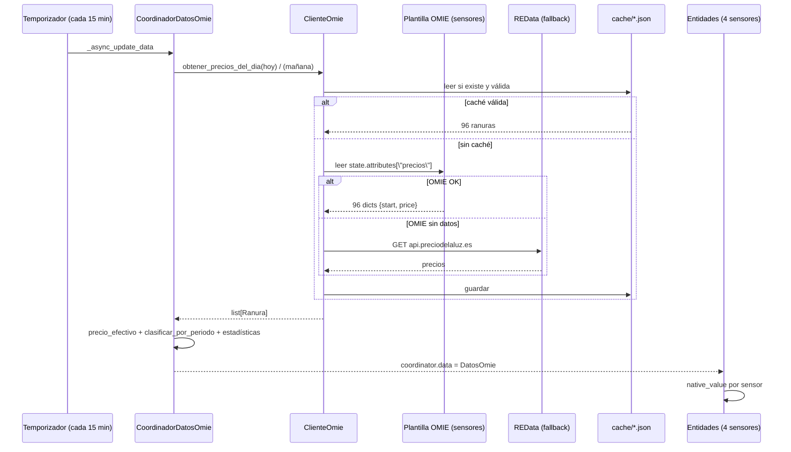
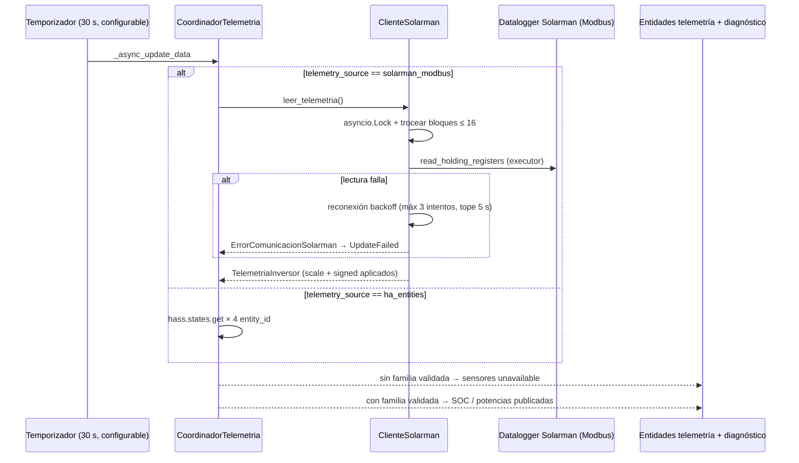

# Diseño y Especificación — `optimizador_bateria_omie` (Actualizado a v0.8.0 con convención Deye)

**Custom component de Home Assistant** para optimizar carga/descarga de batería (inversor Deye vía datalogger Solarman) con precios del mercado eléctrico español en tramos de 15 minutos (OMIE) y predicción de consumo del hogar.

> **Estado del documento** (octubre 2026). Este documento es la **fuente única de verdad** del proyecto.
>
> - **F1** — Precios: ✅ **implementada y en producción doméstica** (manifest **0.7.3**).
> - **F2** — Telemetría Solarman: 🚧 **en ejecución**. Plan `docs/PLAN_F2.md` **v1.2 aprobado** (Opción C, ver §5.2.2). Versión de cierre prevista **0.8.0**.
> - **F3** a **F6** — 🚧 diseño, no implementadas.
>
> A lo largo del documento, cada apartado lleva la marca **✅ F1**, **🚧 F2 (en ejecución)** o **🚧 Fn** según corresponda.

---

## 1. Visión general

El componente se ejecuta dentro de Home Assistant y, en su versión completa (F1–F6), hará lo siguiente:

1. **Obtener los precios del mercado diario OMIE con resolución de 15 minutos** (MTU15, operativo en España desde el 1 de octubre de 2025). ✅ F1
2. **Leer por Solarman (Modbus local)** el estado del inversor Deye: SOC de batería, potencias de carga/descarga, consumo de casa, producción fotovoltaica, estado de red. 🚧 F2 (en ejecución, solo lectura)
3. **Predecir el consumo** de la casa con un modelo que usa histórico + calendario (laborable/festivo/vacaciones, hora, día de semana) + clima (temperatura exterior, irradiancia). 🚧 F3/F5
4. **Calcular un plan horario por tramos de 15 min** que prioriza el autoconsumo y aplica arbitraje (comprar barato / vender caro) solo cuando es rentable tras aplicar la eficiencia round-trip y los parámetros ajustables del usuario. 🚧 F3/F5
5. **Aplicar el plan escribiendo** en el inversor (corriente de carga/descarga, límites de SOC, carga desde red, venta a red) con salvaguardas: modo dry-run, límite de escrituras, watchdog y fallback a autoconsumo básico si algo falla. 🚧 F4

Prioridad de estrategia (fijada por el usuario): **autoconsumo + arbitraje cuando convenga**.

Estado actual: **F1 en producción** (punto 1 completo: precios, precio efectivo 2.0TD, clasificación y estadísticas en 4 sensores de solo lectura). **F2 en ejecución**: añade telemetría local del inversor vía Modbus con mapa de registros configurable, validación por sonda y **sin ninguna escritura al inversor en esta fase**.

---

## 2. Contexto del sistema existente

| Elemento | Detalle |
|---|---|
| Plataforma | Home Assistant Yellow (HAOS), en uso desde ~2023 |
| Inversor | **Deye SUN-6K-SG05LP1-EU-AM2-P** — híbrido monofásico, 6.000 W nominales, PV máx. 7.800 W, rango de batería 40–60 V, corriente máx. de carga/descarga configurable **0–135 A** |
| Batería | **Docan 51,2 V 300 Ah LiFePO4** — **15,36 kWh nominales**; fabricante recomienda 140 A de carga/descarga (máx. 200 A), pero el límite real lo impone el inversor (135 A ≈ 6,9 kW) |
| Datalogger | Solarman serie **3178171873**, IP fija **192.168.1.76**, puerto **8899** |
| Históricos | Node-RED + InfluxDB (producción y consumo), estadísticas de HA |
| **Fuente de precios** | **Integración oficial OMIE** + plantilla `precios_omie.yaml` (ver §5.1) |
| Clima | Integración weather de HA (pendiente de confirmar en F3) |
| Tarifa | Indexada **2.0TD** con **5,75 kW contratados**; peajes y cargos en §5.6 |
| Remuneración de excedentes | **Al mismo precio que la compra** (contrato con mayorista) |

Supuestos confirmados: inversor, batería, datalogger Solarman, tarifa 2.0TD con 5,75 kW y remuneración simétrica.

Pendientes de confirmar: entidad de clima, lista de festivos locales y previsión FV (opcional). En F2: offsets exactos de la familia B dentro de 4210–4233 (TODO en `registers.yaml`).

---

## 3. Requisitos funcionales

### RF-01 — Precios OMIE a 15 minutos ✅ F1

- Consultar el precio del mercado diario español (MDA) con **resolución de 15 minutos** para hoy y mañana, en €/kWh.
- Fuentes en cascada con registro del origen en atributos:
  1. **Sensores de plantilla** `sensor.omie_precios_de_es_ayer`, `_hoy` y `_manana`, creados por el usuario a partir de la acción `omie.get_prices_for_date` de la integración oficial OMIE (ver §5.1).
  2. **REData** (`https://api.preciodelaluz.es/v1/prices?date=...`) como fallback si los sensores no contienen datos.
- **Caché en disco** por día (`cache/YYYY-MM-DD.json`), validada a 96 tramos, que sobrevive a reinicios y evita saturar las fuentes.
- **Refresco**: coordinador cada 15 minutos + triggers de la plantilla (13:35 CET para precios D+1 y 00:05 CET para rotación de día) + arranque de HA.
- **Exponer** (vía sensores): precio del tramo actual, precio efectivo, clasificación por **período 2.0TD** (valle/llano/punta) y estadísticas del día (mín/máx/mediana).

> **Deuda técnica** (§12.3): #1 limpieza de caché por `dias_cache`, #2 backoff/timeout en REData y #7 log con tramos mañana se resuelven en F2; #3 (cliente directo `api.omie.es`) es opcional en F2 y **solo si existe un endpoint a 15 min** — no se interpola el mercado horario.

### RF-02 — Telemetría Solarman 🚧 F2 (en ejecución)

- Conexión **local** al datalogger Solarman vía `pysolarmanv5` (TCP, puerto 8899) mediante Modbus.
- Lecturas periódicas (por defecto cada 30 s) de: SOC, potencia de batería (W, con signo Deye), corriente de batería (A), consumo de casa (W) y producción FV (W).
- **Convención de signos (crítico):** Para evitar romper tarjetas y gráficos existentes, se adopta la **convención nativa de Deye**:
  - **`potencia_bateria` > 0** → **Descarga** (la batería entrega energía).
  - **`potencia_bateria` < 0** → **Carga** (la batería absorbe energía).
  - El `registers.yaml` incluye un flag `invertir_signo` (default `false`) por si en el futuro se necesita invertir la convención sin tocar código.
- **F2 es estrictamente de solo lectura**: no existe método `escribir_registros` en el cliente.

### RF-03 — Control de carga/descarga 🚧 F4

- Servicios para ajustar, en cualquier momento: corriente/potencia de carga, corriente/potencia de descarga, SOC objetivo de carga, SOC mínimo, habilitación de carga desde red, habilitación de venta a red.
- **Mapa de registros configurable en YAML** (`registers.yaml`); el componente no debe hardcodear direcciones. El servicio `probe_registers` (creado en F2) valida la familia antes de permitir escrituras; escrituras bloqueadas hasta validación.
- Límite de seguridad: máximo N escrituras por hora (por defecto 12) y verificación de lectura tras escritura (write-verify).

### RF-04 — Compra/venta con parámetros ajustables 🚧 F4/F5

- Decisión de **comprar** (cargar batería desde red) cuando el precio proyectado del tramo esté por debajo del umbral ajustable y por debajo del precio medio ponderado al que se espera descargar. El coste de compra se valora con el **precio efectivo** = spot + peajes/cargos del tramo (§5.6) + impuestos configurables.
- Decisión de **vender** (verter batería a red más allá del autoconsumo) cuando el precio supere el umbral de venta y compense la eficiencia round-trip (solo si `p_venta ≥ p_compra_efectiva / η_round_trip + margen`). Con el contrato actual la venta se valora **al mismo precio que la compra** (§5.6).
- **Restricción dura de potencia contratada**: la importación total de red (consumo de la casa + carga de batería) nunca superará los **5,75 kW**.
- Todos los umbrales como entidades `number`/`switch` de HA modificables sin reinicios; aplicar cambios recalcula el plan en ≤ 60 s.

### RF-05 — Predicción de consumo 🚧 F3/F5

- Predicción de la curva de consumo por tramos de 15 min para el horizonte del plan (hoy + mañana si hay precios).
- Modelo **avanzado** con variables de calendario y clima:
  - Calendario: hora del día, día de semana, festivo nacional/local (lista configurable), periodos vacacionales configurables, mes/estación.
  - Clima: temperatura exterior (media prevista del tramo), irradiancia/previsión solar si está disponible.
  - Histórico: consumo del mismo tramo en los últimos N días (N configurable, por defecto 28), percentiles por tramo×tipo de día.
- Implementación por capas (fallback en cascada):
  1. **Modelo ML** (Gradient Boosting / LightGBM con scikit-learn), reentrenado semanalmente por noche, con métricas de backtesting (MAPE) expuestas como sensor diagnóstico (F5).
  2. **Perfil estadístico**: mediana del consumo por tramo y tipo de día (laborable/festivo/vacaciones) (F3).
  3. **Persistencia**: consumo del mismo día de la semana anterior.
- La predicción incluye banda de incertidumbre (p10–p90) que el planificador puede usar de forma conservadora.

### RF-06 — Planificador y ejecutor 🚧 F3/F4

- Genera un **plan por tramos de 15 min** con: acción (`AUTOCONSUMO` / `CARGA_RED` / `VENTA_RED` / `MANTENER`), potencia objetivo, SOC previsto, precio de referencia y beneficio marginal estimado.
- Publica el plan como sensor con atributos JSON y lo expone en un dashboard; guarda un **registro de auditoría** de cada decisión, plan aplicado y desviación real vs. previsto.
- Ejecutor con **modo dry-run** (calcula y publica el plan pero no escribe en el inversor) — obligatorio en la fase inicial de puesta en marcha.
- Recalcula ante: llegada de precios nuevos, cambio de parámetros, desviación > X % entre SOC real y previsto (por defecto 10 %), o fallo de comunicación.

---

## 4. Arquitectura

### 4.1 Diagrama de componentes

```mermaid
flowchart TD
  subgraph Fuentes
    OMIE[\"Integración OMIE + plantilla\n(sensores omie_precios_de_es_*)\"]
    REDATA[\"REData\n(fallback)\"]
    SOLAR[\"Datalogger Solarman\n(Modbus TCP, puerto 8899)\"]
    HAENT[\"Entidades Solarman HA\n(opcional ha_entities)\"]
    WEATHER[\"Clima / calendario\n(F3+)\"]
    HIST[\"Histórico consumo\n(F3+)\"]
  end
  subgraph Componente[\"optimizador_bateria_omie\"]
    PRICE[\"ClienteOmie ✅ F1\"]
    TARIFF[\"ModeloTarifa ✅ F1\"]
    COORD[\"CoordinadorDatosOmie ✅ F1\"]
    CONFIG[\"Config Flow + Entidades ✅ F1\"]
    MAPA[\"MapaRegistros 🚧 F2\"]
    TELEM[\"ClienteSolarman 🚧 F2\"]
    CTEL[\"CoordinadorTelemetria 🚧 F2\"]
    PROBE[\"probe_registers 🚧 F2\"]
    FORECAST[\"ConsumptionForecaster 🚧 F3/F5\"]
    PLANNER[\"Planner 🚧 F3/F5\"]
    EXECUTOR[\"Executor 🚧 F4\"]
    AUDIT[\"Audit / Stats 🚧 F5\"]
  end
  OMIE --> PRICE
  REDATA --> PRICE
  SOLAR --> TELEM
  HAENT --> CTEL
  MAPA --> TELEM
  TELEM --> CTEL
  PROBE --> TELEM
  HIST --> FORECAST
  WEATHER --> FORECAST
  PRICE --> TARIFF
  PRICE --> COORD
  TARIFF --> COORD
  TARIFF --> PLANNER
  COORD --> CONFIG
  CTEL --> PLANNER
  FORECAST --> PLANNER
  CONFIG --> PLANNER
  PLANNER --> EXECUTOR
  EXECUTOR --> SOLAR
  PLANNER --> AUDIT
  CTEL --> AUDIT
```

### 4.2 Ciclo de actualización (F1) ✅



### 4.3 Ciclo de telemetría (F2) 🚧



### 4.4 Máquina de estados de la batería (F4+, referencia)


---

## 5. Módulos del componente

### 5.1 `ClienteOmie` ✅ F1

Fichero: `custom_components/optimizador_bateria_omie/cliente_omie.py`.

**Clases públicas**:
- `ConfiguracionOmie(fuente_prioritaria, usar_cache, dias_cache)`.
- `Ranura(fecha_hora_utc, precio_eur_kwh, fuente, fecha_publicacion, fecha_hora_fin_utc)`.
- `ErrorFuenteOmie`, `ErrorIntegracionNoDisponible`.
- `ClienteOmie(hass, config)`.

**Métodos**:

| Método | Descripción |
|---|---|
| `_obtener_desde_integracion_omie(fecha)` | Localiza el sensor `sensor.omie_precios_de_es_{ayer,hoy,manana}` correspondiente (usando fecha **local**) y devuelve `state.attributes["precios"]` como `list[dict]` con `{start, price}`. Devuelve `[]` si no hay datos. |
| `_obtener_desde_redata(fecha)` | HTTP GET a `api.preciodelaluz.es`. Devuelve `list[dict]` o `[]`. 🚧 F2: `ClientTimeout(total=10)` explícito + 2 reintentos con backoff (0,5 s, 2 s). |
| `_normalizar_a_15min(datos, fecha)` | Convierte `list[dict]` a `list[Ranura]`. Solo soporta el formato OMIE `{start, end, price}` con timezone. Loguea warning si no se obtienen exactamente 96 ranuras. |
| `obtener_precios_del_dia(fecha)` | Flujo completo: caché → cascada de fuentes (OMIE → REData) → normalización → persistir caché. Lanza `ErrorFuenteOmie` si todas las fuentes fallan. |
| `limpiar_cache_antigua(dias)` 🚧 F2 | (deuda #1) Borra `cache/*.json` con `mtime > dias * 86400`, en executor. Ejecutado en el arranque y por job diario a las 04:30. |

**Decisiones de diseño de F1**:

| Aspecto | Decisión | Motivo |
|---|---|---|
| Fuente primaria | Sensores de plantilla OMIE | La integración oficial ya gestiona autenticación, parsing y publicación D+1. Reimplementar la API sería duplicar mantenimiento. |
| Fuente de fallback | Solo REData | `apidatos.ree.es` no publica a 15 min de forma fiable; ESIOS requiere token personal y su parser merece una fase propia. |
| Formatos soportados en `_normalizar_a_15min` | **Solo** `{start, end, price}` | Formatos legacy (hour/minute, datetime, JSON-string) eliminados en 0.7.0 por no usarse nunca. |
| Relleno a 96 ranuras | **No** se rellena con ceros | Enmascaraba fallos; si faltan ranuras, se loguea warning y se devuelve lo que haya. |
| Caché | Válida solo si tiene **exactamente 96 ranuras** | Evita que un JSON con `[]` o incompleto bloquee la fuente real. |
| Zona horaria | Selección de sensor por **fecha local** (`datetime.now().astimezone().date()`) | Los sensores de plantilla se indexan por `now().date()` local; compararlos con UTC desfasaba 2 h en CEST. |

**Plantilla externa requerida** (`precios_omie.yaml`): sin cambios respecto a F1 (tres sensores `omie_precios_de_es_{ayer,hoy,manana}` alimentados por `omie.get_prices_for_date` con triggers a las 13:35 y 00:05).

**F2+**: `_obtener_desde_api_omie()` es **opcional** y solo se implementará si se confirma un endpoint de la API pública a **15 min**. La API de mercado entrega precios **horarios**: interpolar a 15 min está prohibido (inventar valores). En caso negativo, queda TODO documentado.

### 5.2 `ClienteSolarman` 🚧 F2 (en ejecución)

Ficheros: `solarman_client.py` (clase **`ClienteSolarman`**, convención española de F1), `telemetria.py` (`TelemetriaInversor` + `CoordinadorTelemetria`), `mapa_registros.py` (`MapaRegistros`).

**`ClienteSolarman(hass, ip, puerto, serie, mapa: MapaRegistros)`**:

- Crea `PySolarmanV5` bajo demanda en executor.
- `leer_registros(addr, qty)`: trocea a bloques ≤ 16, serializa con `asyncio.Lock`.
- **Reconexión con backoff acotado**: 3 intentos máx, tope 5 s por intento (peor caso ≈ 10 s), sin bloquear más de un ciclo.
- `leer_telemetria(familia: str) -> TelemetriaInversor`: **la familia llega por parámetro** (el cliente no consulta el Store). Aplica `scale`, `signed` (two's complement 16-bit) e `invertir_signo` si procede.
- **No incluye `escribir_registros`** en F2 (reservado a F4).

**`TelemetriaInversor`** (dataclass):
- `soc: float | None`
- `potencia_bateria: float | None` (W, **+ descarga / − carga** — convención Deye)
- `corriente_bateria: float | None` (A)
- `consumo_casa: float | None` (W)
- `produccion_fv: float | None` (W)
- `ts_actualizacion: datetime`

**`CoordinadorTelemetria`**:
- Intervalo `intervalo_telemetria_s` (default 30 s).
- `_async_update_data()`: si `solarman_modbus` y no hay familia validada → `UpdateFailed` **antes** de tocar Modbus (evita conexiones inútiles). Si hay familia, delega en `ClienteSolarman`.

**`MapaRegistros`**:
- Carga `registers.yaml` con prioridad: `config/optimizador_bateria_omie/registers.yaml` (override usuario) > empaquetado.
- API: `familias()`, `direccion()`, `parametros()` (incluye `invertir_signo`), `plausibility()`, `probe()`, `block_size`.
- Aplica two's complement 16-bit si `signed: true` y luego `invertir_signo` si es `true`.

**Persistencia de validación**: `hass.storage.Store` (clave `optimizador_bateria_omie/probe.json`) guarda `{familia, probe_addr, probe_funcion, ultima_validacion_ts}`. Al arrancar, si `probe_addr` cambió en el YAML, se invalida.

**Config flow (F2)**: campos nuevos con defaults editables (`ip`, `puerto`, `serie`, `telemetry_source`, `intervalo_telemetria_s`, 4 `entity_id` condicionales). `async_step_reconfigure` para editar sin recrear.

### 5.2.2 Modificaciones confirmadas del plan F2 (v1.2, Opción C)

| # | Modificación |
|---|---|
| **C3** | **Signo Deye**: `potencia_bateria` = **+ descarga / − carga**. `registers.yaml` incluye `signo_semantico` e `invertir_signo` (default `false`). |
| **C4** | `leer_telemetria(familia: str)`: familia por parámetro; el coordinador resuelve. |
| **C5** | `UpdateFailed` **antes** de tocar Modbus si no hay familia validada. |
| **M1** | Tolerancia ±2 % en `probe_registers`. |
| **M2** | Plausibilidad parametrizada en `registers.yaml` (SOC 0–100, |P_bat| ≤ 7000 W). |
| **M3** | `reset: true` en `probe_registers` borra la validación. |
| **M4** | Backoff acotado (3 intentos, tope 5 s/intento). |
| **M5** | Limpieza de caché en arranque + job diario 04:30 (idempotente). |
| **M6** | `async_step_reconfigure` en config flow. |
| **M7** | `register` opcional (default: `probe.addr`); `familia` opcional. |
| **M8** | Conversión signed two's complement 16-bit explícita + test con valor negativo. |
| **M9** | `supports_response=SupportsResponse.OPTIONAL` en el servicio. |
| **M10** | Sensor diagnóstico `familia_validada` con estado `ninguna | A | B`. |
| **M11** | (Nuevo) `SensorCorrienteBateria` como 5º sensor de telemetría. |
| **M12** | (Nuevo) `InversorFake` con `connect()`/`disconnect()`. |
| **M13** | (Nuevo) `pysolarmanv5>=1.1.0,<2.0.0` en requirements. |
| **M14** | (Nuevo) Override de `registers.yaml` en `config/optimizador_bateria_omie/`. |

### 5.3 Mapa de registros Deye (`registers.yaml`) 🚧 F2

⚠️ **El SUN-6K-SG05LP1-EU-AM2-P monta placa de la generación "AM2"**, cuya dirección de registros difiere de las generaciones anteriores. La comunidad documenta dos familias candidatas; el componente arranca en modo `probe` y **solo habilita escrituras tras validar la familia correcta**:

| Función | Familia A (placas nuevas SG04LP3/AM2/HP3) | Familia B (placas clásicas SG01/03LP1) |
|---|---|---|
| SOC / potencia batería | 586–591 (588 SOC, 590 potencia ±, 591 corriente) | 4210–4233 aprox. (**offsets exactos TODO**) |
| Corriente de carga objetivo | 128 (A, 0–135 para 6 kW) | dentro del bloque TOU |
| Flags de control (carga red, SOC límites) | 108, 130, 166, 172 | 4341 y afines |
| Time-of-Use (slots) | direcciones propias de la placa, hasta 6 slots | 4310–4312 (habilitación), 4315–4338 (6 programas) |

Señalización comunitaria: en esta generación conviene limitar las peticiones Modbus a bloques ≤ 16 registros para evitar timeouts.

Esquema del `registers.yaml` (perfil `deye-sun-6k-sg05lp1-am2`, dos familias):

```yaml
inverter: "deye-sun-6k-sg05lp1-am2"
block_size: 16
familias:
  A:                       # placas nuevas SG04LP3 / AM2 / HP3
    probe:
      funcion: soc
      addr: 588
    plausibility:
      soc: [0, 100]
      potencia_bat: [-7000, 7000]
    telemetria:
      soc:            { addr: 588, scale: 0.1, unit: "%" }
      potencia_bat:   { addr: 590, scale: 1,   unit: "W", signed: true, invertir_signo: false, signo_semantico: "+descarga/-carga" }
      corriente_bat:  { addr: 591, scale: 0.1, unit: "A", signed: true }
      consumo_casa:   { addr: 670, scale: 0.1, unit: "W" }
      produccion_fv:  { addr: 633, scale: 0.1, unit: "W" }
    control:                # solo lectura en F2; ningún código de F2 lo invoca
      corriente_carga: { addr: 128, min: 0, max: 135 }
      carga_desde_red: { addr: 166 }
      limite_carga:    { addr: 172, min: 10, max: 100 }
      limite_descarga: { addr: 108, min: 10, max: 100 }
  B:                       # placas clásicas SG01/03LP1
    probe:
      funcion: soc
      addr: 4212           # TODO: dirección exacta del SOC dentro de 4210-4233
    telemetria:
      soc:            { addr: 4212, scale: 1, unit: "%" }   # TODO confirmar
      potencia_bat:   { addr: 4214, scale: 1, unit: "W", signed: true }  # TODO
      consumo_casa:   { addr: 4226, scale: 0.1, unit: "W" }  # TODO
      produccion_fv:  { addr: 4229, scale: 0.1, unit: "W" }  # TODO
    control:
      tou_habilitacion: { addr: 4310 }
      tou_programas:   { addr: 4315, qty: 24 }
```

Notas:
- Las direcciones son **configuración, no constantes de código**; el acceso pasa siempre por `MapaRegistros`. Si falta una dirección: `TODO` documentado y se continúa sin esa magnitud.
- Los `TODO` de la familia B son advertencias del validador, no errores: la comunidad documenta el bloque 4210–4233, no el offset exacto de cada magnitud. El validador del mapa no rompe el arranque por un TODO.
- El bloque `control` se incluye por completitud (F4 lo usará); en F2 **ningún código lo invoca**.

### 5.4 `ConsumptionForecaster` 🚧 F3/F5

- Entrenamiento nocturno (semanal) sobre el histórico de consumo a 15 min con features: `tramo_dia (0-95)`, `dia_semana`, `es_festivo`, `es_vacaciones`, `temperatura_media_prevista`, `irradiancia_prevista`, `consumo_mismo_tramo_{7,14,21,28}d`.
- Salida: `prediccion[tramo] = {p50, p10, p90}` en W.
- Backtesting walk-forward con métricas (MAPE, sesgo) → sensor `sensor.optimizador_bateria_omie_forecast_quality` (F5).
- Reentrenamiento bajo `job` de HA; modelo persistido en `directorio_datos_integración/model.pkl`. Dependencias admitidas: scikit-learn. **Excluidas**: torch, tensorflow.

### 5.5 `Planner` 🚧 F3/F5

- **Entrada**: precios (96–192 tramos), predicción consumo (p50/p90), predicción FV si existe, estado batería, parámetros.
- **Estrategia en dos capas**:
  1. **Autoconsumo siempre**: la batería absorbe `consumo − FV` cuando `SOC > soc_min` (respetando potencia de descarga); nunca carga batería desde red por debajo de `soc_min` salvo decisión de arbitraje.
  2. **Arbitraje**: en tramos de precio bajo, carga desde red hasta `soc_max` si el coste esperado del ciclo completo supera un margen ajustable. En tramos caros, descarga adicional a red hasta `soc_min` solo si el precio neto de venta lo justifica.
- **Implementación**:
  - **F3**: greedy con reglas heurísticas, en `dry_run`.
  - **F5**: programación lineal entera mixta con PuLP/SciPy. Variables: energía comprada/vendida/almacenada por tramo; restricciones de potencia, SOC y **potencia contratada ≤ 5,75 kW**. Tamaño ≈192 variables × 4, resuelve en <1 s.
- El plan incluye `coste_sin_plan` vs. `coste_con_plan` → **ahorro estimado del día**, expuesto como sensor.

### 5.6 `ModeloTarifa` ✅ F1

Fichero: `custom_components/optimizador_bateria_omie/tarifa.py`.

**Clases públicas**:
- `ConfiguracionTarifa(potencia_contratada_kw=5.75, impuesto_electrico_pct=0.051127, iva_pct=0.21, aplicar_impuestos_precio=True)`.
- `PeriodoTarifa` (métodos estáticos `es_punta`, `es_llano`, `es_valle`).
- `ModeloTarifa(config)`: cálculo completo.

**Cargos por energía** (se suman al spot para el precio efectivo de compra):

| Período | Días | Horas locales | Peaje €/kWh | Cargo €/kWh | **Total €/kWh** |
|---|---|---|---|---|---|
| Punta | L–V | 10:00–14:00 y 18:00–22:00 | 0,033261 | 0,064292 | **0,097553** |
| Llano | L–V | 08:00–10:00, 14:00–18:00 y 22:00–24:00 | 0,016409 | 0,012858 | **0,029267** |
| Valle | L–V | 00:00–08:00 | 0,000077 | 0,003215 | **0,003292** |
| Valle | S–D y festivos nacionales | 00:00–24:00 | 0,000077 | 0,003215 | **0,003292** |

**Cargos por potencia** (solo informes, no afectan decisiones F1):

| Periodo | Franja | Peaje €/kW·día | Cargo €/kW·día |
|---|---|---|---|
| P1 | L–V 08:00–24:00 | 0,063904 | 0,011999 |
| P2 | L–V 00:00–08:00, S–D y festivos | 0,001216 | 0,000772 (×30 días/mes) |

**Fórmula**:

```
precio_compra_efectivo(tramo) = (spot_15min + peaje + cargo) × (1 + IE) × (1 + IVA)
```

con IE = 5,1127 % y IVA = 21 % por defecto (configurables en `ConfiguracionTarifa`).

**Restricción de potencia contratada** (aplicable en F4+): importación total (consumo casa + carga batería) ≤ **5,75 kW**. El planificador limitará la carga de la batería a `5,75 kW − consumo previsto − margen`; el Executor añadirá un guard dinámico que reduce la corriente de carga si la importación medida supera el 95 %.

**Zona horaria y clasificación** (corregido en 0.7.1):

- `PeriodoTarifa` evalúa los horarios sobre la **hora local del sistema** (`datetime.astimezone()`), respetando automáticamente CET/CEST.
- `obtener_periodo(fecha_hora_utc)` convierte primero la fecha UTC a local y clasifica:
  - **Fines de semana y festivos nacionales → `valle` todo el día.**
  - Laborables: `punta` (10–14 h y 18–22 h), `llano` (8–10 h, 14–18 h y 22–24 h), `valle` (resto).
- El sensor `precio_clasificacion` usa **`clasificar_por_periodo`** (período 2.0TD real), **no** `clasificar_por_percentiles`. La clasificación por percentiles se conserva como utilidad auxiliar reservada para el planner (F3+).

**Funciones implementadas**:

| Método | Retorno |
|---|---|
| `obtener_periodo(fecha_hora_utc)` | `"punta"` / `"llano"` / `"valle"` según hora local + festivos + fines de semana |
| `obtener_peaje_cargo(periodo)` | Suma peaje + cargo del periodo |
| `obtener_precio_efectivo(precio_spot, fecha_hora_utc)` | Precio con peajes + cargos + impuestos |
| `clasificar_por_periodo(fechas_hora_utc)` | Lista de `"valle"` / `"llano"` / `"punta"` por período 2.0TD. **Usado por el sensor.** |
| `clasificar_por_percentiles(precios)` | Utilidad auxiliar (tercios por percentil). **No usada por el sensor**; reservada para el planner (F3+). |
| `obtener_estadisticas(precios)` | `{"min", "max", "mediana"}` |
| `es_festivo(fecha)` | Bool contra `FESTIVOS_ESPANA` |
| `es_fin_de_semana(fecha)` | Bool (sábado/domingo) |

### 5.7 `CoordinadorDatosOmie` ✅ F1

Fichero: `custom_components/optimizador_bateria_omie/coordinador.py`.

**Dataclass `DatosOmie`**:
```python
@dataclass
class DatosOmie:
    precios_hoy: list[Ranura]
    precios_manana: list[Ranura] | None
    clasificaciones_hoy: list[str]
    clasificaciones_manana: list[str] | None
    estadisticas_hoy: dict
    estadisticas_manana: dict | None
    fuente: str
    ts_actualizacion: datetime
```

**Método principal**: `async _async_update_data() -> DatosOmie`. `update_interval = timedelta(minutes=15)`. En caso de éxito devuelve `self._datos` (imprescindible para que `coordinator.data` se rellene); en caso de fallo actualiza `_datos` a valores vacíos y lanza `UpdateFailed`.

En el ciclo de actualización, las clasificaciones se calculan **por período 2.0TD**:

```python
clasificaciones_hoy = self.modelo_tarifa.clasificar_por_periodo(
    [r.fecha_hora_utc for r in precios_hoy]
)
# análogamente para precios_manana
```

**Métodos públicos**:
- `obtener_precio_actual() -> float | None`: busca la ranura vigente por `datetime.now(tz=UTC)`.
- `obtener_precio_efectivo_actual() -> float | None`.
- `obtener_clasificacion_actual() -> str | None`: calcula el índice con `(ahora - precios_hoy[0].fecha_hora_utc) // 900 s` y devuelve `clasificaciones_hoy[idx]`.
- `obtener_estadisticas_actual() -> dict`.
- `_buscar_ranura(ranuras, ahora)`: helper.

**Detalle crítico**: `_buscar_ranura` recorre las ranuras comparando `fecha_hora_utc <= ahora < fecha_hora_fin_utc`. Como `ahora` está en UTC y las ranuras se almacenan en UTC, la comparación es correcta independientemente de la zona local. Para cubrir la madrugada local (00:00–02:00 CEST), `obtener_precio_actual` cae a `precios_manana` si no encuentra coincidencia en `precios_hoy`.

**🚧 F2 (deuda #7)**: el log de éxito pasa a `Datos actualizados. Fuente: X, tramos hoy: N, tramos mañana: M`.

### 5.8 `entidades.py` ✅ F1 (+ `entidades_solarman.py` 🚧 F2)

Fichero: `custom_components/optimizador_bateria_omie/entidades.py`.

**Clase base**:

```python
class SensorBase(CoordinatorEntity, SensorEntity):
    _attr_has_entity_name = True

    @property
    def device_info(self) -> DeviceInfo:
        return DeviceInfo(
            identifiers={(DOMAIN, "optimizador_bateria_omie")},
            name="Optimizador Batería OMIE",
            manufacturer="Custom Component",
            model="Optimizador Batería OMIE",
        )
```

> ⚠️ **La herencia de `SensorEntity` es crítica**. Sin ella, `Entity.state` devuelve `STATE_UNKNOWN` y `native_value` no se consulta nunca. Fue el bug raíz que mantuvo los sensores en `unknown` durante la depuración de la versión 0.6.x.

**Clases de sensor F1**: `SensorPrecioActual`, `SensorPrecioEfectivo`, `SensorPrecioClasificacion`, `SensorPrecioEstadisticas`. Ver §6 para detalles.

**🚧 F2 — `entidades_solarman.py`**: cuatro sensores con la misma base (`CoordinatorEntity, SensorEntity`, `has_entity_name`, mismo `device_info` — mismo dispositivo que los 4 de precios), más un sensor diagnóstico (M10):

| Clase | unique_id | Unidad | Estado |
|---|---|---|---|
| `SensorSocBateria` | `optimizador_bateria_omie_soc_bateria` | % | SOC |
| `SensorPotenciaBateria` | `optimizador_bateria_omie_potencia_bateria` | W | + carga / − descarga |
| `SensorConsumoCasa` | `optimizador_bateria_omie_consumo_casa` | W | consumo instantáneo |
| `SensorProduccionFv` | `optimizador_bateria_omie_produccion_fv` | W | producción FV |
| `SensorFamiliaValidada` (diagnostic) | `optimizador_bateria_omie_familia_validada` | — | `ninguna` / `A` / `B` |

### 5.9 `sensor.py` ✅ F1 (+ extensión F2)

Setup de la plataforma. Lee `entry.data` para construir `ConfiguracionOmie` con los parámetros elegidos en el config flow (no con defaults hardcodeados). Crea el `ClienteOmie`, el `CoordinadorDatosOmie`, ejecuta `async_config_entry_first_refresh()` (no rompe si falla) y añade las cuatro entidades.

**🚧 F2**: además, siempre que haya entrada de telemetría (con defaults), crea `MapaRegistros` + `CoordinadorTelemetria` y añade las 5 entidades de §5.8. `ClienteSolarman` solo se instancia si `telemetry_source == solarman_modbus`.

### 5.10 `config_flow.py` ✅ F1 (+ extensión F2)

- Un solo paso `user` con `CONFIG_SCHEMA` de tres campos (F1).
- `VERSION = 1` (se mantiene en F2).
- `_abort_if_unique_id_configured()`: instancia única.
- Sin `OptionsFlow` en F1 (deuda #4, F3).
- **`fuente_prioritaria`** restringido a `vol.In(["omie", "redata"])`.
- **`dias_cache`** con `vol.All(int, vol.Range(min=1, max=30))`.

**🚧 F2**: campos nuevos en el esquema (§5.2): `ip`, `puerto`, `serie`, `telemetry_source`, `intervalo_telemetria_s` y 4 `entity_id` condicionales (esquema dinámico en dos pasos `user` → `telemetria`). La entrada de producción se lee con `entry.data.get(clave, default)` — sin migración ni bump de `VERSION` (D11). **`async_step_reconfigure`** para editar la entrada existente sin borrarla y recrearla (M6).

---

## 6. Entidades y servicios de Home Assistant

### 6.1 Entidades implementadas ✅ F1

Los `entity_id` dependen del nombre del dispositivo/entrada de configuración. En la instalación de referencia son `sensor.inversor_optimizador_bateria_omie_*`. Los `unique_id` son estables: `optimizador_bateria_omie_precio_actual`, `_precio_efectivo`, `_precio_clasificacion`, `_precio_estadisticas`.

#### `sensor.*_precio_actual`

| Campo | Valor |
|---|---|
| Estado | Precio del tramo actual (€/kWh, 4 decimales) o `unknown` si no hay tramo vigente |
| Unidad | €/kWh |
| Atributos | `fuente`: `omie` / `redata` / `desconocida` |
| Disponibilidad | `obtener_precio_actual() is not None` |

#### `sensor.*_precio_efectivo`

| Campo | Valor |
|---|---|
| Estado | Precio efectivo = `(spot + peaje + cargo) × (1 + IE) × (1 + IVA)`, 4 decimales |
| Unidad | €/kWh |

#### `sensor.*_precio_clasificacion`

| Campo | Valor |
|---|---|
| Estado | `valle` / `llano` / `punta` **según período 2.0TD** (no por percentiles) |
| Unidad | — |

Comportamiento:
- **Fines de semana y festivos nacionales** → `valle` todo el día.
- **Laborables**: `punta` (10–14 h y 18–22 h), `llano` (8–10 h, 14–18 h, 22–24 h), `valle` (00–08 h). Todo en hora local (CET/CEST).

#### `sensor.*_precio_estadisticas`

| Campo | Valor |
|---|---|
| Estado | **Mediana** del día (€/kWh) |
| Atributos | `min`, `max`, `mediana`, `fuente`, `ts_actualizacion` |

### 6.2 Entidades F2 — telemetría 🚧 F2 (en ejecución)

`unique_id` con prefijo `optimizador_bateria_omie_` (detalles en §5.8):

| Entidad | Tipo | Descripción |
|---|---|---|
| `sensor.*_soc_bateria` | sensor (%) | SOC de la batería |
| `sensor.*_potencia_bateria` | sensor (W, signed) | + carga / − descarga |
| `sensor.*_consumo_casa` | sensor (W) | consumo instantáneo |
| `sensor.*_produccion_fv` | sensor (W) | producción fotovoltaica |
| `sensor.*_familia_validada` | diagnostic | `ninguna` / `A` / `B` — expone por qué la telemetría está `unavailable` sin abrir logs |

Los cuatro sensores de telemetría **no publican valores hasta que exista familia validada** (modo `solarman_modbus`); hasta entonces quedan `unavailable`.

### 6.3 Entidades planificadas 🚧 F3–F5

Todas con prefijo `optimizador_bateria_omie_*` en sus `unique_id`:

| Entidad | Tipo | Descripción | Fase |
|---|---|---|---|
| `sensor.*_prediccion_consumo` | sensor | W previstos del tramo actual; atributo curva p10/p50/p90 | F3 |
| `sensor.*_plan` | sensor | acción y potencia del tramo actual; atributo plan completo | F3 |
| `sensor.*_ahorro_hoy` | sensor | € ahorrados acumulados | F5 |
| `sensor.*_forecast_quality` | diagnostic | MAPE del último backtest | F5 |
| `switch.*_activo` | switch | habilita/deshabilita la escritura (dry-run cuando off) | F4 |
| `switch.*_permitir_carga_red` | switch | arbitraje de compra | F4 |
| `switch.*_permitir_venta_red` | switch | arbitraje de venta | F4 |
| `switch.*_festivo_hoy` | switch | marca manual de festivo/vacaciones | F3 |
| `number.*_precio_max_compra` | number (€/kWh) | umbral de compra | F4 |
| `number.*_precio_min_venta` | number (€/kWh) | umbral de venta | F4 |
| `number.*_margen_arbitraje` | number (€/kWh) | margen mínimo | F4 |
| `number.*_soc_min` / `_soc_max` | number (%) | límites operativos | F4 |
| `number.*_potencia_max_carga` / `_descarga` | number (W) | límites de potencia | F4 |
| `number.*_potencia_max_red` | number (W) | potencia contratada / importación máxima | F4 |
| `number.*_eficiencia_round_trip` | number (%) | 70–95 | F4 |

### 6.4 Servicios

**F2 🚧 — `optimizador_bateria_omie.probe_registers`** (semántica v1.1 con M1–M3 y M7; registrado con `supports_response=SupportsResponse.OPTIONAL`):

```yaml
optimizador_bateria_omie.probe_registers:
  fields:
    expected:
      description: "Valor esperado: el SOC % que muestra la pantalla o la APP Solarman"
      example: 73
      required: true
      selector:
        number: {}
    register:
      description: "Dirección a sondear (opcional; por defecto, el probe.addr de cada familia)"
      example: 588
      required: false
      selector:
        number:
          min: 1
          max: 9999
    familia:
      description: "Sondear solo esta familia (opcional)"
      example: "A"
      required: false
      selector:
        select: { options: ["A", "B"] }
    reset:
      description: "Borra la validación persistida y vuelve a unavailable, sin sondear"
      example: true
      required: false
      default: false
      selector: { boolean: {} }
```

Comportamiento:
1. `reset: true` → borra `familia_validada` del `hass.storage`, telemetría vuelve a `unavailable`, respuesta `{"reset": true}`. Fin.
2. Lee el registro SOC de cada familia (o de la indicada en `familia`) vía Modbus.
3. Compara con `expected` con **tolerancia ±2 %** (M1) y verifica **plausibilidad** de la familia (M2: `|potencia_bat| ≤ 7000 W`, SOC en 0–100). Respuesta por familia: `leído`, `esperado`, `desviacion_pct`, `plausible`, `resultado`.
4. Si **exactamente una** familia acierta SOC + plausibilidad → persiste `familia_validada` en `hass.storage` y recarga la telemetría. Si ambas o ninguna → `WARNING`, sin validación (escrituras siguen bloqueadas).

**F3/F4 🚧** (referencia, no implementados):

```yaml
# Regenerar plan ya (tras cambiar parámetros)
optimizador_bateria_omie.regenerate_plan: {}

# Aplicar manualmente un modo hasta una hora dada
optimizador_bateria_omie.force_mode:
  mode: carga_red | venta_red | autoconsumo | apagado
  until: "23:00"

# Volver al plan automático
optimizador_bateria_omie.release_manual: {}
```

---

## 7. Parámetros ajustables

### 7.1 Config flow actual ✅ F1 (+ campos F2 🚧)

Tres claves F1, persistidas en `entry.data`:

| Parámetro | Tipo | Defecto | Rango / valores |
|---|---|---|---|
| `fuente_prioritaria` | selección | `omie` | `omie`, `redata` |
| `usar_cache` | bool | `true` | — |
| `dias_cache` | int | `7` | 1–30 |

Campos nuevos F2 (defaults editables, leídos con `entry.data.get(clave, default)`; la entrada de producción de F1 no se rompe):

| Parámetro | Tipo | Defecto | Rango / valores |
|---|---|---|---|
| `ip` | str | `192.168.1.76` | — |
| `puerto` | int | `8899` | 1–65535 |
| `serie` | str | `3178171873` | — |
| `telemetry_source` | selección | `solarman_modbus` | `solarman_modbus`, `ha_entities` |
| `intervalo_telemetria_s` | int | `30` | 10–300 |
| `entity_id_soc`… (×4) | str | vacío | solo con `ha_entities`; TODO documentado, sin inventar ids |

Sin `OptionsFlow` hasta F3 (deuda #4); `async_step_reconfigure` disponible desde F2 (M6).

### 7.2 Modelo de tarifa actual ✅ F1

Hardcodeado en `tarifa.py` (mover a `entry.data` es deuda #5, F4):

- Peajes y cargos de §5.6. Impuesto eléctrico 5,1127 %. IVA 21 %. `aplicar_impuestos_precio = true`.
- Potencia contratada 5,75 kW (declarada; no aplicada como restricción en F1).

### 7.3 Esquema completo planificado 🚧 (referencia, no implementado)

```yaml
optimizador_bateria_omie:
  omie:
    source: omie                       # omie | redata
    valorar_venta_como_compra: true
    precio_venta_factor: 1.0
  tarifa:
    potencia_contratada_kw: 5.75
    margen_potencia_w: 300
    impuesto_electrico_pct: 5.1127
    iva_pct: 21
    aplicar_impuestos_precio: true
    energia:
      punta: { dias: laborables, horas: ["10:00-14:00", "18:00-22:00"], peaje: 0.033261, cargo: 0.064292 }
      llano: { dias: laborables, horas: ["08:00-10:00", "14:00-18:00", "22:00-24:00"], peaje: 0.016409, cargo: 0.012858 }
      valle: { horas: ["00:00-08:00"], peaje: 0.000077, cargo: 0.003215 }
    potencia:
      p1: { dias: laborables, horas: "08:00-24:00", peaje_kw_dia: 0.063904, cargo_kw_dia: 0.011999 }
      p2: { peaje_kw_dia: 0.001216, cargo_kw_mes: 0.000772 }
  solarman:
    ip: 192.168.1.76
    puerto: 8899
    serie: 3178171873
    telemetry_source: solarman_modbus   # o ha_entities
    intervalo_telemetria_s: 30           # 10-300
    register_profile: deye-sun-6k-sg05lp1-am2
  battery:
    capacidad_kwh: 15.36
    voltaje_nominal: 51.2
    corriente_max_a: 135
    soc_min: 15
    soc_max: 95
    potencia_max_carga_w: 5000
    potencia_max_descarga_w: 5000
    eficiencia_round_trip: 88
  strategy:
    permitir_carga_red: true
    permitir_venta_red: true
    precio_max_compra: 0.09
    precio_min_venta: 0.18
    margen_arbitraje: 0.015
  forecast:
    ventana_historico_dias: 28
    usar_clima: true
    weather_entity: weather.casa
    festivos: ["01-01", "06-01", "12-10", "01-11", "06-12", "25-12"]
    vacaciones_rangos: [["2026-07-01", "2026-08-31"]]
  seguridad:
    dry_run: true
    max_escrituras_por_hora: 12
    desviacion_soc_replan_pct: 10
```

En F4+, los parámetros de `strategy`, `battery` y `seguridad.dry_run` se expondrán como entidades modificables en caliente (config flow + `options`).

---

## 8. Fases de implementación

| Fase | Alcance | Estado | Criterio de salida |
|---|---|---|---|
| **F1 — Precios** | `ClienteOmie` (plantilla + REData + caché) + `ModeloTarifa` + `CoordinadorDatosOmie` + 4 sensores + config flow | ✅ **completada** (0.7.1; rama main 0.7.3) | Precios del tramo coinciden con `sensor.omie_precios_de_es_hoy`; clasificación coherente con períodos 2.0TD; precio efectivo validado contra facturación esperada 3 días seguidos |
| **F2 — Solarman** | `ClienteSolarman` (Modbus local, solo lectura) + `MapaRegistros` + `registers.yaml` (familias A/B) + servicio `probe_registers` (tolerancia, plausibilidad, reset) + 5 entidades de telemetría + deuda F1 (#1, #2, #7; #3 opcional) | 🚧 **en ejecución** (PLAN_F2 v1.1 confirmado; cierre previsto 0.8.0) | SOC y potencias coinciden con la APP Solarman; familia A/B validada con tolerancia + plausibilidad (resetable); **ninguna escritura**; `pytest` en verde (incluida regresión de los 62 tests de F1) + `ruff check` limpio |
| **F3 — Predicción v1 + Planificador greedy** | Forecaster estadístico (perfil por tramo×tipo de día) + planner greedy en `dry_run`; sensor plan + ahorro estimado; OptionsFlow (deuda #4) | 🚧 pendiente | Plan diario plausible revisado manualmente 1 semana en `dry_run` |
| **F4 — Control** | Executor con write-verify, límite de escrituras, fallback y watchdog; activación real gradual (solo carga desde red en valle nocturno) | 🚧 pendiente | 1 semana sin errores; verificación de escrituras en inversor |
| **F5 — ML + LP** | Forecaster ML (calendario+clima), optimización LP, banda p90, auditoría de ahorro real, reentrenamiento semanal | 🚧 pendiente | MAPE de backtest < 20 % en tramos de alto consumo; ahorro real medible |
| **F6 — Pulido** | Dashboard Lovelace completo, notificaciones de decisiones relevantes, exportación de informes mensuales | 🚧 pendiente | Uso continuado 30 días sin intervención |

---

## 9. Seguridad y resiliencia

### 9.1 Principios no negociables

- `dry_run` por defecto `true` (aplica en F4+): el plan se publica pero nunca escribe hasta validación explícita del usuario.
- **Write-verify**: tras cada escritura, relectura del registro; a los 3 fallos consecutivos → estado `fallback` (reestablecer modo autoconsumo nativo del inversor) y deshabilitar escrituras hasta intervención.
- **Escrituras bloqueadas hasta validación de familia** (F2+): `escribir_registros()` levanta `ErrorEscriturasDeshabilitadas` sin `familia_validada` persistida; en F2, además, nadie lo invoca.
- **Nunca permitir**: SOC objetivo < límite de descarga del inversor, corrientes > límites del `registers.yaml`, escrituras cuando el inversor reporte alarma/fault.
- **Guard de potencia contratada**: la importación medida (consumo + carga batería) nunca debe superar **5,75 kW**; si supera el 95 %, el Executor reduce la corriente de carga de la batería.
- **Si no hay precios para el día siguiente** → plan solo con lo disponible; si tampoco hay datos hoy → mantener autoconsumo (no inventar planes). Análogamente: **sin familia validada no se publica telemetría** (no inventar valores del mapa equivocado) y **no se interpola el mercado horario a 15 min** (deuda #3).
- **Auditoría inmutable** (JSONL en directorio de datos) de: cada plan, cada escritura, cada error.

### 9.2 Aplicación en F1 ✅ y F2 🚧

En F1 solo aplica:

- El coordinador **nunca escribe** en ningún dispositivo: todos los sensores son de solo lectura.
- Si todas las fuentes de precios fallan, `_async_update_data` lanza `UpdateFailed` y los sensores quedan en `unavailable`/`unknown` (no se inventan valores).
- La caché se valida a 96 entradas antes de usarse; un JSON corrupto o incompleto se descarta y se vuelve a pedir a la fuente.
- Los logs de éxito incluyen fuente y nº de tramos (F2 añade `tramos mañana` y desviación — deuda #7).

En F2 se añade:

- **F2 es estrictamente de solo lectura**: ningún método escribe en el inversor; el método de escritura queda guardado por `ErrorEscriturasDeshabilitadas`.
- Peticiones Modbus troceadas a ≤ 16 registros, serializadas con `asyncio.Lock`, en executor; backoff acotado que nunca bloquea más de un ciclo del coordinador (M4).
- Datos de conexión como defaults editables del config flow, nunca constantes de código.

---

## 10. Pruebas exigidas (CI)

### 10.1 F1 ✅ (en suite, pendiente de añadir a CI; 62 tests en verde)

- `tests/test_normalizar_a_15min.py`: cubre 96 tramos nominales, día con cambio horario (92/100 tramos), formato con `end` y sin `end`, formatos inválidos.
- `tests/test_cliente_omie.py`: mock de `hass.states.get` devolviendo `precios` válidos, vacíos y ausentes; verifica la selección del sensor por fecha local.
- `tests/test_tarifa.py`:
  - `obtener_precio_efectivo` para los tres periodos.
  - `obtener_periodo` con casos de laborable/punta, laborable/llano, laborable/valle, sábado, domingo y festivo nacional.
  - `clasificar_por_periodo` sobre una lista de timestamps que cubre un día laborable completo y un domingo completo; verifica que **todos los tramos del domingo son `valle`**.
  - `clasificar_por_percentiles` (utilidad auxiliar) con distribuciones conocidas.
- `tests/test_coordinador.py`: `_async_update_data` con `ClienteOmie` mockeado; verifica `return self._datos`, el manejo de `UpdateFailed` y que `clasificaciones_hoy` proviene de `clasificar_por_periodo`.

### 10.2 F2 🚧 (en ejecución)

- `tests/fake_inversor.py` — **simulador fake reutilizable**: `InversorFake` con mapa de registros `dict[int, int]` (familias A y B), misma interfaz Modbus que `PySolarmanV5` (`read_holding_registers`, `write_multiple_holding_registers`) + inyección de fallos (timeouts, desconexiones, contador de llamadas, assert de tamaño máximo de bloque ≤ 16). `PySolarmanV5` nunca se usa directamente en tests: el fake se inyecta en `ClienteSolarman`.
- `tests/test_solarman_client.py`: lecturas correctas por familia; **troceado de bloques > 16** (se piden 32 y el fake registra dos peticiones ≤ 16); semáforo (accesos concurrentes serializados); **reconexión con backoff acotado** (primer intento falla, segundo OK; 3 intentos máx con tope 5 s); timeout (N fallos → `ErrorComunicacionSolarman`); **conversión signed two's complement** con valor negativo de potencia (M8); `escribir_registros` siempre levanta `ErrorEscriturasDeshabilitadas`.
- `tests/test_probe_registers.py`: familia A valida (SOC dentro de tolerancia ±2 % + plausibilidad), familia B no; coincidencia de SOC **sin** plausibilidad → sin validación (M2); **ninguna** acierta → sin validación y escrituras bloqueadas; `reset: true` borra el flag (M3); flag persistido en storage mock se lee al reinicializar; respuesta del servicio con `desviacion_pct` por familia (M1).
- `tests/test_mantenimiento.py` (deuda F1): limpieza de caché (ficheros con `mtime > dias_cache * 86400` borrados, recientes conservados; **también en arranque**, M5) y backoff de REData (timeout explícito 10 s, 2 reintentos; `async_get_clientsession` parcheado como en F1).
- Tests del config flow: entrada de producción sin campos nuevos no se rompe (`entry.data.get`), esquema dinámico con `ha_entities`, `async_step_reconfigure` (M6).
- Regresión completa de la suite de F1 (62 tests).

### 10.3 F3+ (referencia)

- `tests/test_planner.py`: escenarios día valle/punta clásico, precio negativo, rampa de precios, SOC inicial 0/50/100, venta deshabilitada, restricción de potencia contratada.
- `tests/test_forecaster.py`: dataset sintético + backtesting reproducible (seed fija).

### 10.4 Herramientas

- `pytest` con `pytest-homeassistant-custom-component` (fallback: hass mockeado con `MagicMock`, como en F1, documentado en `RESULTADO_F2.md`).
- Lint: `ruff check` + constraints de HA y Python.
- Se aceptan fixtures JSON de OMIE/REData con casos reales de días de cambio horario.

---

## 11. Estructura del repositorio (estado F1, + ficheros F2)

```
optimizador-bateria-omie/
├── custom_components/
│   └── optimizador_bateria_omie/
│       ├── __init__.py          # async_setup_entry / async_unload_entry (+ F2: registro probe_registers, carga validación, job limpieza caché)
│       ├── manifest.json        # versión, requisitos (+ F2: pysolarmanv5, PyYAML; 0.8.0)
│       ├── const.py             # DOMAIN, defaults, ATTR_*, FESTIVOS_ESPANA (+ F2: CONF_IP, CONF_PUERTO, CONF_SERIE, CONF_TELEMETRY_SOURCE, CONF_INTERVALO_TELEMETRIA, SERVICE_PROBE_REGISTERS)
│       ├── config_flow.py       # ConfigFlow (instancia única) (+ F2: campos telemetría, async_step_reconfigure)
│       ├── cliente_omie.py      # ClienteOmie + Ranura + errores (+ F2: limpiar_cache_antigua, backoff REData)
│       ├── tarifa.py            # ModeloTarifa + ConfiguracionTarifa + PeriodoTarifa
│       ├── coordinador.py       # CoordinadorDatosOmie + DatosOmie (+ F2: log tramos mañana)
│       ├── entidades.py         # SensorBase + 4 sensores
│       ├── sensor.py            # setup de plataforma (+ F2: telemetría)
│       ├── strings.json         # Etiquetas del config flow
│       ├── cache/               # (runtime) YYYY-MM-DD.json
│       ├── tests/
│       │   └── (suite F1, 62 tests)
│       ├── registers.yaml       # 🚧 F2 (familias A/B)
│       ├── mapa_registros.py    # 🚧 F2 MapaRegistros
│       ├── solarman_client.py   # 🚧 F2 ClienteSolarman
│       ├── telemetria.py        # 🚧 F2 TelemetriaInversor + CoordinadorTelemetria
│       ├── entidades_solarman.py# 🚧 F2 4 sensores + diagnostic
│       ├── services.py          # 🚧 F2 probe_registers
│       ├── services.yaml        # 🚧 F2
│       └── translations/es.json # 🚧 F2
├── hacs.json
├── README.md
├── SPEC.md
└── docs/
    ├── INSTALACION.md
    └── PLAN_F2.md              # 🚧 F2 (v1.1)
```

**Convención de nombres**:

- Ficheros y clases en **español** (consistencia interna): `cliente_omie.py`, `solarman_client.py`, `Ranura`, `ModeloTarifa`, `ClienteSolarman`, `MapaRegistros`, `CoordinadorTelemetria`.
- `unique_id` de sensores con prefijo del dominio: `optimizador_bateria_omie_precio_actual`, `optimizador_bateria_omie_soc_bateria`.
- `entity_id` derivado del `device_info`; en la instalación de referencia resulta `sensor.inversor_optimizador_bateria_omie_*`.

**Ficheros futuros** (F3+): `forecaster.py`, `planner.py`, `executor.py`.

**Paquetes nuevos F2**: `pysolarmanv5` (manifest, pre-autorizado por AGENTS.md), `PyYAML` (manifest, OK confirmado), `pytest-homeassistant-custom-component` + `pysolarmanv5` (venv de tests, OK confirmado).

---

## 12. Datos pendientes y deuda técnica

### 12.1 Confirmados

- Inversor Deye SUN-6K-SG05LP1-EU-AM2-P.
- Batería Docan 51,2 V 300 Ah (15,36 kWh).
- Datalogger Solarman (serie 3178171873, IP 192.168.1.76, puerto 8899).
- Tarifa 2.0TD con 5,75 kW contratados.
- Remuneración de excedentes al mismo precio que la compra.
- Fines de semana y festivos nacionales → **valle** todo el día (confirmado; coincide con tarifa 2.0TD estándar).
- **F2**: `telemetry_source` por defecto `solarman_modbus` (entity_id de `ha_entities` quedan como campos vacíos con TODO).

### 12.2 Pendientes de confirmar

1. **Entidad de clima** de HA a usar y lista de **festivos locales** (más allá de los nacionales ya incluidos en `FESTIVOS_ESPANA`) — F3.
2. **Previsión de producción FV** (Solcast u otro) — opcional, mejora el plan — F3+.
3. **`probe_registers`**: familia de registros A/B válida para la placa AM2 (verificación con hardware, por el usuario; bloquea F4).
4. **Offsets exactos de la familia B** dentro de 4210–4233 (TODO en `registers.yaml`).
5. **Endpoint de la API pública OMIE a 15 min**: condición para implementar la deuda #3 (opcional en F2).

### 12.3 Deuda técnica registrada

| # | Elemento | Fase de resolución | Estado |
|---|---|---|---|
| 1 | `ConfiguracionOmie.dias_cache` se guarda pero **no se aplica**: no hay job de limpieza de caché vieja. Añadir tarea diaria (04:30) **y pasada en arranque** que borre `cache/*.json` con `mtime > dias_cache * 86400`. | F2 | 🚧 en resolución |
| 2 | **Reintentos con backoff** en `_obtener_desde_redata`: `ClientTimeout(total=10)` explícito + 2 reintentos (0,5 s, 2 s). | F2 | 🚧 en resolución |
| 3 | **Sustituir dependencia de la plantilla OMIE** por cliente directo contra `api.omie.es`. **Opcional y condicionado**: solo si existe endpoint a 15 min; el mercado horario **no se interpola** (prohibido inventar valores). Si no, queda TODO documentado. | F2 (opcional) | 🚧 condicionada |
| 4 | **`OptionsFlow`** en `config_flow.py` para editar `fuente_prioritaria`, `usar_cache` y `dias_cache` sin borrar y recrear la entrada. (`async_step_reconfigure` llega en F2 — M6.) | F3 | pendiente |
| 5 | **Mover parámetros de tarifa** (peajes, cargos, impuestos, potencia) a `entry.data` en lugar de estar hardcodeados en `tarifa.py`. | F4 | pendiente |
| 6 | **Carpeta `tests/`** con los ficheros descritos en §10.1, incluyendo el caso explícito de domingo/festivo todo `valle`. | F2 (suite F1 ya en verde: 62 tests) | 🚧 en resolución |
| 7 | **Trazabilidad de ciclos**: log de éxito `Datos actualizados. Fuente: X, tramos hoy: N, tramos mañana: M` (+ desviación). | F2 | 🚧 en resolución |
| 8 | **Limpieza puntual de entidades duplicadas `_2`** tras el cambio de `unique_id` de 0.7.0 → 0.7.1. Acción manual documentada: borrar las 8 entidades `optimizador_bateria_omie_*` desde la UI y reiniciar HA. **No requiere cambio de código**; migración única. | Manual, una vez | pendiente (manual) |

---

## 13. Fuentes y referencias

- **OMIE** — Mercado Ibérico de la Electricidad: https://www.omie.es. Nota de prensa *go-live MTU15* (1 de octubre de 2025). Precios del mercado diario por periodo (H1Q1…).
- **REData** (`api.preciodelaluz.es`) — fallback de precios a 15 min.
- **ESIOS** (`api.esios.ree.es`) — pendiente para F2+ (requiere token personal).
- **pysolarmanv5** — librería de referencia para dataloggers Solarman en local: https://pysolarmanv5.readthedocs.io.
- **Datasheet Deye SUN-6K-SG05LP1-EU** — 6.000 W, PV 7.800 W, carga/descarga 0–135 A en modelo 6 kW, batería 40–60 V.
- **Docan Power LiFePO4 51,2 V 300 Ah** — corriente recomendada 140 A, máx. 200 A.
- **Foros comunitarios de registros Modbus Deye** — varían por modelo y generación; validar siempre con `probe_registers` antes de operar.
- **Home Assistant Developer Docs** — `DataUpdateCoordinator`, `CoordinatorEntity`, `SensorEntity`, `ConfigFlow`, `hass.storage`, `SupportsResponse`.
- **Tarifa 2.0TD (BOE)** — peajes y cargos vigentes; estructura de períodos punta/llano/valle; fines de semana y festivos nacionales = valle todo el día.